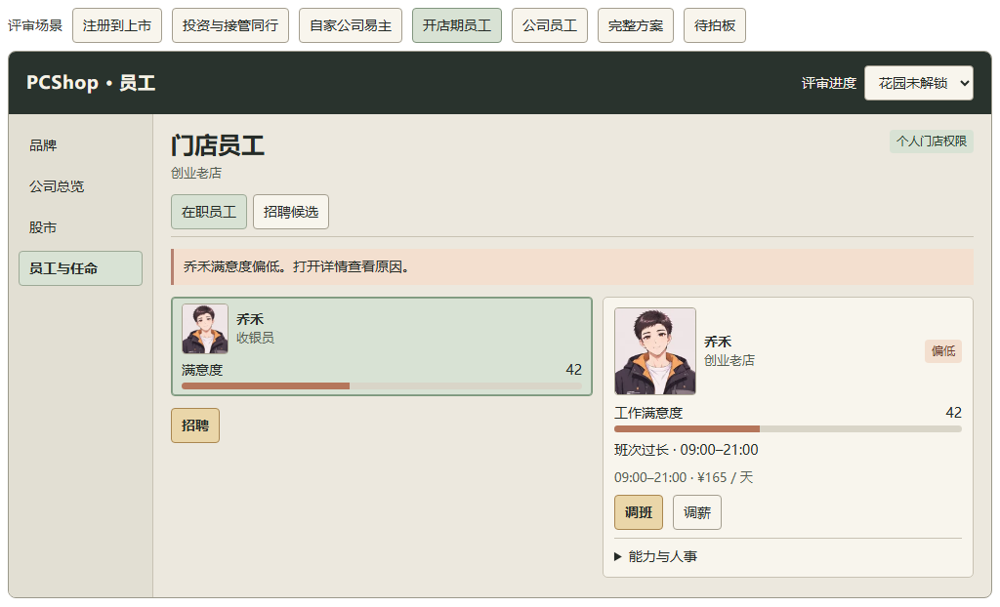
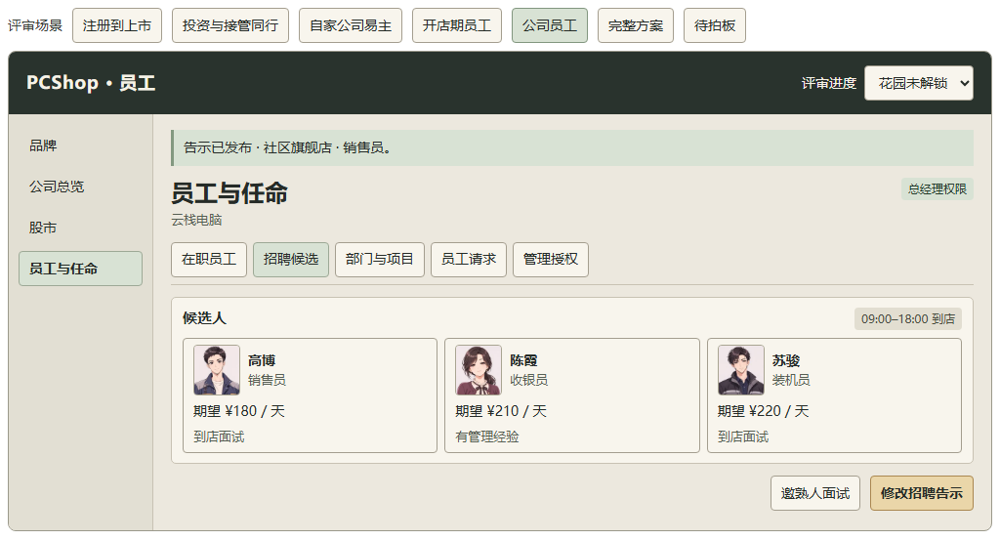
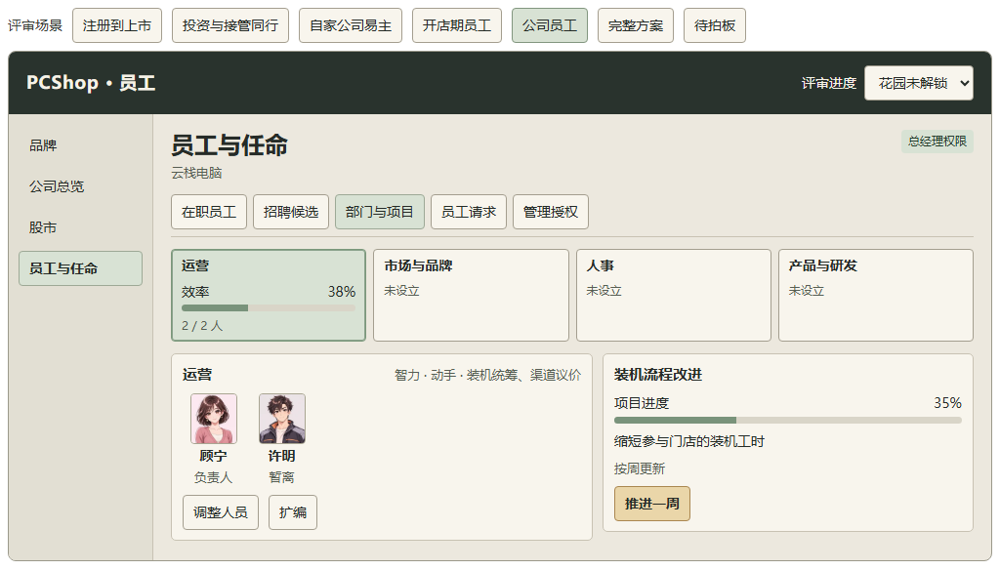
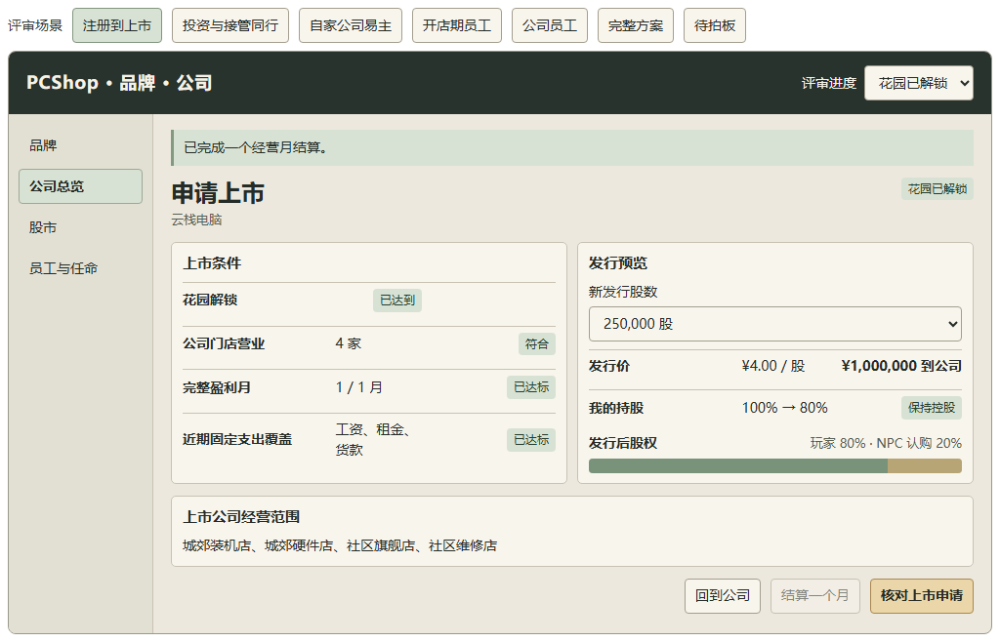
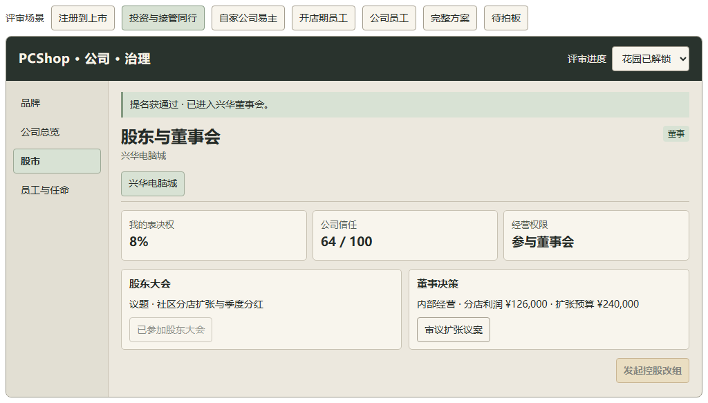
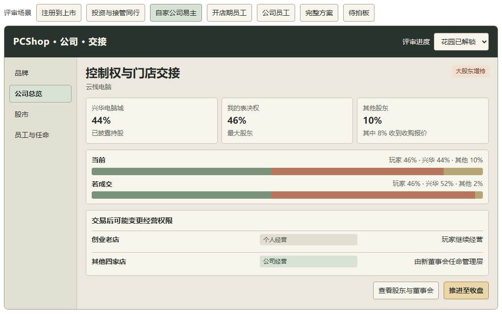
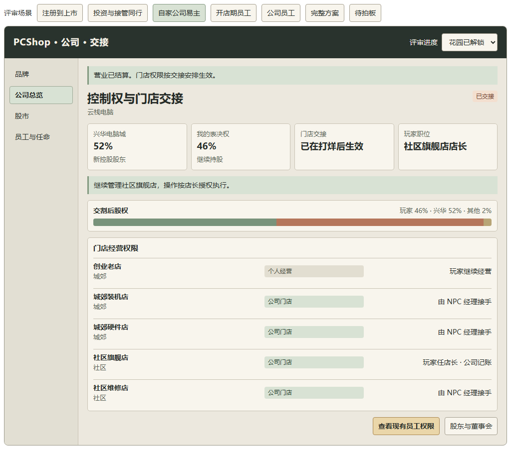

# 品牌、公司、股权与员工设计交接

2026 年 11 月 23 日 · 设计评审稿

这套玩法把 PCShop 已有的门店、品牌和股市连起来。玩家从第一家店开始带员工，注册品牌时成立公司，用实际门店经营积累业绩。解锁花园后可以上市、买同行股票、进董事会或控股接管，NPC 也可以反过来取得玩家公司的控制权。本文是换机后的设计交接入口，正文和附图都可从仓库读取。

## 已拍板的边界

| 事项 | 已定规则 |
| --- | --- |
| 品牌与公司 | 保留「品牌」。注册一个品牌即成立同名公司，一品牌一公司。由玩家全资起步。品牌继续承接推广、直播、展会和竞标。 |
| 开放时机 | 第一家店聘人就有员工满意度。公司成立后可以开设部门和任命管理职务。第三阶段以主线实际解锁**花园**为准，届时开放玩家买 NPC 公司股份、IPO 和 NPC 买入玩家公司股份。 |
| 市场与治理 | 单机内的玩家和 NPC 公司参与。玩家能当普通股东、争取董事席位或控股接管。NPC 对玩家公司适用同一套股权和控制规则。 |
| 公司易主 | 个人门店继续由玩家经营。公司门店由公司管理层接手。玩家获邀留任时可继续管约定门店，也可以只保留股东身份。 |
| 超编 | 先显示人数、编制和可处理选项。暂停招聘、调岗、扩编或裁员由有权限的人操作。超编状态下，现有员工继续在职，岗位和工资照常结算。 |
| 界面 | 员工、候选人、部门成员和申请优先用 PCShop 现有立绘头像。常用操作和关键状态同屏。部门效率、项目进度、满意度、精力和股权分布用图形配文字和数值。 |

## 第一家店到成立公司

### 门店员工满意度

现有招聘告示和到店面试继续用于首店。每名在职员工从入职起有一份工作满意度记录，和员工对玩家的个人好感独立。员工列表直接显示头像、岗位和满意度。点头像后，同屏查看当前日薪、班次、主要原因和可用操作。精力可在公司管理侧作为任务能力展示，首店界面先突出最需要处理的满意度问题。

- 按已实际执行的班次和薪资变化结算满意度。工资低于期望、连续长班、缺人造成的工作量、岗位不合适都可以成为原因。调班或调薪登记后，等新安排执行再反映到满意度。
- 低满意度先给明确原因。持续偏低时，员工提出加薪、调班、休假或换岗等具体请求。长期没有解决才出现离职风险，给玩家安排替班和交接的机会。
- 工资属于实际雇主的开支。跨雇主调动需要员工接受新安排，先结清原雇主的工资，再从生效班次改记新雇主。临时外出采购、装机订单和排班沿用现有任务交接逻辑。
- 满意度跟随员工。注册公司、门店划入公司、换经理以及公司易主时，保留员工满意度、已有经验、已承诺班次和待处理请求。旧档迁移建议从中性基准开始，再按后续真实经营变化。

原型例子是创业老店的乔禾。满意度 42，原因是连续长班。玩家在同屏将班次从 09:00–21:00 改为 09:00–18:00，走过新班次后示例数值回到 48。数值用于说明反馈时机。

### 注册品牌与门店归属

沿用当前注册资格和品牌定位。注册即得到未上市公司，创始人初始持股 100%。旧档已有品牌按同一规则接入，保留品牌 ID、名称、门店关联和已有合同。挂品牌招牌与把生意纳入公司经营分别设置。原型默认先挂品牌，门店保持个人经营，玩家再选择哪几家划入公司。

- 划入确认单逐店显示库存、在途采购、订单、员工和已承诺支出。约定交割时点后才改变相应经营归属。历史账按交易发生时的归属保留，切换门店归属只影响此后的业务。
- 公司有独立现金与账务。公司门店营收和支出走公司账。由公司出资开的店归公司。个人店可按约定使用公司品牌，公司只记录实际收取的授权或服务收入。
- 上市后把公司店转回个人或从个人转入公司，需要明确报价、公司审批与付款，交割记录列出受到影响的员工和业务。公司出售门店所得进公司账户。

## 公司员工、部门与项目

总经理和店长是管理职务，收银、装机、采购和销售是工作岗位。一名员工可以兼任，但同一时段的工时只能用一次。部门项目、门店岗位、外出采购、培训和休假共用排班；界面在安排前提示原店是否需要替班。

| 身份 | 日常权限 |
| --- | --- |
| 控股人和董事会 | 决定经营预算和总经理人选，按规则审批分红、增发、关店和重大扩张。独资期间由玩家行使这些权限。 |
| 总经理 | 在预算内经营公司，任免店长、组织招聘、调薪、跨店调人、批准培训和休假。玩家可以亲任或委托 NPC。 |
| 店长 | 负责指定门店的排班、补货和授权范围内定价。可以筛候选人、发起招聘，或经授权在预算内聘用。超编、超预算或超出授权的人事变更提交给有权限的人。 |
| 普通员工和部门负责人 | 保留实际岗位。部门负责人承担部门排班和项目执行。免职可回原岗，辞退则终止雇佣，两种操作分开。 |

### 任用与培养

- 招聘可用门店告示，也可邀请熟人面试。候选人卡显示头像、拟任岗位、期望日薪和管理经验。选中后看四项能力、适岗信息和雇主，再录用、谢绝或提交审批。
- 任命和调岗预览生效班次、原岗位空缺、岗位薪资和替班需要。辞退预览应付工资、待完成工作和空缺，沿用在途采购须先交回人与货的限制。解除董事席位和结束雇佣是两种变化。
- 公司员工额外展示精力和专长。精力反映当前能承担的任务，满意度影响是否提出改善要求和愿不愿继续留下。培训花公司预算并占用班次，可提升现有属性或发现专长。休假恢复精力，同时需要处理岗位覆盖。批准、推迟或拒绝员工请求都给出反馈。
- 管理授权集中设置招聘审批和单店预算。薪资清单预览全公司日薪总额。上市后可由财务和董事会议题反映高额薪资调整、缺岗或离职对周转与交付的实际影响。
- 超编时显示「实际人数／编制」，可暂停招聘、跨店调岗或扩编。人工裁员仍须显示工资和交接影响。超编提示示例是录用后出现 4／3 人，确认扩编后显示 4／4，原员工安排保留。

### 部门与项目

公司按需设立和扩充部门。界面上方用卡片并列显示部门效率和编制，选中后左侧是负责人、成员头像和空位，右侧是项目预算、进度和作用。人数、部门专长、实际在岗、精力和工作满意度决定可用工作能力；出差、培训和休假减少可用工时。效率和进度口径属于设计建议，具体计算参数属于后续经济校准。

| 部门 | 首批项目示例 | 游戏内结果 |
| --- | --- | --- |
| 运营 | 装机流程改进 | 缩短参与门店实际装机工时。采购、物流和跨店协调也可复用现有工作流。 |
| 市场与品牌 | 季度展会筹备 | 完成展品、接待等准备，降低展前临时用工压力，结算沿现有展会。 |
| 人事 | 新员工带教 | 缩短新员工适应岗位的时间，支持后续排班替补和人才培养。 |
| 产品与研发 | 自有装机套餐 | 交付一套能在所属门店销售的套餐。其他行业后续接各自已有商品和服务。 |

玩家在部门页选择空位安排员工，选中头像可查看人岗适配。确认前显示从哪个门店或部门调来、是否需要替班、谁负责项目。立项消耗公司资金，有人在岗时才正常推进。项目完成后先写入实际经营结果，再通过财报、公告和投资者预期影响估值。

## 解锁花园后的市场玩法

### 开放条件与 IPO

解锁花园由现有主线状态判断。花园开放后，玩家可以直接买 NPC 股票，即使自家公司还未上市。自己的公司仍需满足经营资格，上市由玩家自行决定。花园前可以经营全资公司、安排公司人员、配置门店归属与预览上市。现有证券教学可提前保留行情和新闻入口。旧档已有持仓建议可查、可正常分红和卖出，新增买入和治理按花园门槛控制。做空开仓、旧空仓退出和已有特殊标的沿用兼容审查，避免读档后出现无法处理的持仓。

IPO 建议条件为至少一家实际营业的公司门店、有完整盈利月、公司现金覆盖近期工资、租金和货款。申请页同屏给出资格、发行股数、发行价、预计公司到账、发行后持股及经营范围。首发由 NPC 认购新股。玩家出售旧股的收入归卖方，新股认购款进入公司账户，增发前预览原股东的认购和稀释结果。

例子中创始人原有 100 万股，以每股 ¥4 新发 25 万股。发行后总股本为 125 万股，公司到账 ¥100 万，创始人变为 80%。报价、估值和发行份额均为评审参数。

### 股价、分红和股份来源

- **经营基本面**读取公司实际归属的门店销售、已售商品成本、工资、房租、合同交付和推广成本。开新店和促销先产生成本，经营结果逐步进入财报和估值。玩家能查到涨跌相关的报告和经营事件。
- **事件与成交**使用现有新闻、报价、走势图和手续费。中标、展会表现、口碑变化和股东大会结果先影响预期，实际经营决定变化能否延续。大单消耗卖盘，也可引入可衰减的短期价格冲击。
- **分红**建议沿用现有季度节奏，按实际总股本、可分配利润和现金储备计算，有现金才支付并同步除息。玩家个人现金、公司现金、利润和股权市值分别展示。
- **股份归属**记录总股本、具名股东及公众持股、实际可卖股数。买入有卖方，卖盘刷新来自持有人新挂单。大宗交易可向持有足够股份并愿意出售的具名股东报价。NPC 同样受资金和可卖数量约束。

### 参会、董事席位与控股

建议普通股东拥有分红和公开财报权限。达到参会门槛后，参加股东大会、提问、发言和按股表决。原型使用持股 1% 参会、持股 5% 加公司信任 60 进入董事候选。董事需经提名或表决，获席后看内部经营摘要、审议扩张、分红、增发和经理任免。持股或信任变化后的改选规则后续核定。

玩家和 NPC 都以超过 50% 表决权作为明确的控股线。达到后主动发起改组并选择原经理留任、另聘经理或自己上任。刚好 50% 时仍需争取其他股东支持。股东、董事、总经理和店长的席位与权限分别记录。优先以已有上市标的兴华电脑城、潮流服饰和纸风车潮玩承接同行接管。

控股一家 NPC 公司后，建议首版支持任命经理、定经营预算、扩张、推广和分红。通过现有 NPC 公司轻量经营状态体现变化。继续买到全资、换股合并和破产清算可沿用股东名册、资金与交割规则深化，首轮未纳入必须完工的范围。

## NPC 取得玩家公司控制权后的交接

玩家接受入股、增发或卖出大宗股份时，确认页显示成交后持股和受影响门店。NPC 在市场集中股份时，证券消息披露大股东持股和潜在变更；接近阈值时可对照成交前后比例。交易成交先更新股东名册。新控股人行使任命权，实际门店权限在选定的营业结算点生效，营业中顾客、待交付订单和在途采购留有明确去向。

| 门店及职位 | 交接结果 |
| --- | --- |
| 玩家个人门店 | 玩家继续经营，雇员、库存和盈亏按原归属处理。原品牌使用按授权约定，玩家可换回店名继续经营。 |
| 公司门店，玩家留任 | 玩家选择接受新管理层的留任条件。按授权管理指定店的排班、补货、理货和定价。公司记经营账，玩家获薪资和所持股份对应分红。 |
| 公司门店，玩家未留任 | NPC 经理接手。员工、工资、库存、订单和公司合同延续，员工精力、满意度、工龄和待办按交接清单保留。玩家保留股东权益，可以参与治理或以后买回控制权。 |

原型情境包含五家门店。公司经营其中四家，创始人保留自己的创业老店。兴华从 44% 增持到 52%，玩家持有 46%。玩家可继续管理个人老店，也可接受公司社区旗舰店店长邀请。其余公司店由新管理层经营。NPC 购买玩家旧股、认购新增股份、向公众或其他股东买入是不同交易，各自记录资金流向和持股变化。

## 界面取舍与需要拍板的项目

品牌、公司、股市和员工保留为主要入口。IPO 从公司总览打开，董事会从公司或持仓进入，控制权交接从公司通知打开。员工页采用头像选择和同屏详情，调班、调薪、培训和休假就地展开。部门采用概览卡、成员空位和项目进度条。入股、转移控制权、辞退等有明显后果的操作保留简短确认。头像来自仓库现有 PCShop 角色，数值和职务是界面示例。

| 待拍板 | 当前推荐及另一选择 |
| --- | --- |
| 上市盈利期 | 一个完整盈利月，并检查近期周转。可改成连续两个盈利月，延长挂牌前的成长阶段。 |
| 首发能否直接放掉控制权 | 首发后创始人保留过半，后续增发和旧股出售可以失去多数。也可开放挂牌当天主动让渡控制权。 |
| NPC 同行接管深度 | 先用轻量经营支持经理、预算、门店扩张、推广和分红。进入同行实体店摆货架、收银属于更大的后续选项。 |
| 部门用人 | 首版允许门店员工按班次兼任，减少抽调后的门店工时。也可以优先给部门单设专职岗位和预算。 |
| 经理招聘权 | 默认经理筛人和排班，玩家确认聘用、调薪和辞退。可单独授权经理在预算内聘用，调薪和辞退仍显示审批。 |
| 辞退补偿 | 首版结清工资和加班费并结算交接影响。是否额外按工龄支付补偿待定。 |

IPO 金额、参会持股比例、董事提名的持股与信任门槛、满意度恢复速度、离职触发天数、部门容量、NPC 出价频率及项目效果留待平衡。原型中的数值用于评审交互、条件和结果显示，Unity 数值以项目经济校准为准。

## 工程现状与换机入口

当前进度停在设计评审，本文及截图是跨电脑交接。品牌、现货证券和现有门店员工已经在 Unity 中；自有公司、股东名册、换控权限、部门项目与员工满意度属于后续开发范围。继续工作时先对照本篇已拍板和待拍板表，再从 `main` 主工作树和以下入口梳理已有代码。

| 现有入口 | 后续接入点 |
| --- | --- |
| [花园与街区进度](../Assets/Scripts/Core/Session/GameSession.Districts.cs) · [主线配置](../Assets/Scripts/Core/Session/DistrictNarrativeCatalog.cs) | 湖城的花园为 `DistrictAccessTier` 第 3 层，对接真实主线解锁，顾及试玩专用进度。 |
| [品牌注册及归属](../Assets/Scripts/Core/Session/GameSession.Brands.cs) · [品牌状态](../Assets/Scripts/Core/Session/BrandBusinessState.cs) · [品牌报表](../Assets/Scripts/Core/Session/GameSession.BrandOverview.cs) | 保留原品牌 ID 和合作进度。现有品牌报表按当前门店关系归集，公司财务需要为业务发生时的公司归属留记录。 |
| [证券行情及结算](../Assets/Scripts/Core/Session/GameSession.StockMarket.cs) · [上市标的](../Assets/Scripts/Core/Session/CityAssets.cs) · [证券页](../Assets/Scripts/Game/UI/GameUi.StockPhone.cs) | 当前 UI 从固定标的目录取股票。报价可成交量与持有人名册分别处理。现有固定股本分红口径要接支持增发后的实际股本。 |
| [员工岗位与招聘](../Assets/Scripts/Core/Session/GameSession.EmployeeAssignments.cs) · [员工调动与采购](../Assets/Scripts/Core/Session/GameSession.Workforce.cs) · [工资和班次](../Assets/Scripts/Core/Session/GameSession.Payroll.cs) · [员工界面](../Assets/Scripts/Game/UI/GameUi.Employees.cs) | 复用员工 ID、岗位、班次、在途限制和工资结算，补雇主、管理职务、满意度、精力和部门工时。 |
| [财务归属](../Assets/Scripts/Core/Finance/LedgerAttribution.cs) · [股市说明](90-stock-market-and-short-selling.md) · [当前玩法与界面](150-current-gameplay-and-neighborhood-ui-2026-11-23.md) | 区分公司经营、个人持股、募资、内部划转和分红。手机、银行和居家入口调用同一权限判断。 |

后续交付时重点核对三条完整路径。新人长班触发原因提示，调班后在实际结算时恢复。解锁花园前后同一路线的证券权限不同，IPO 资金和股本同步落账。双向接管只改变已划入公司的经营权限，读档后员工、库存、持股和合同仍能接着走。以上是评审验证用例，游戏实现需另行安排。

## 《东京股神》参考

- 公司经营更新明确了建部门、按部门安排关键员工、培训和休假，以及员工主动提出加薪或放假的玩法。员工有独立的精力和工作满意度。部门画面把头像、岗位和效率集中展示。 [公司经营更新](https://steamcommunity.com/games/1539140/announcements/detail/3793779874933454483) · [部门实机图](https://clan.fastly.steamstatic.com/images/39729459/cea6d0fd81b9af60fd7e877d82a3508f399c9802.png)
- 更新加入薪资调整面板和部门专长提示。原作超编会自动辞退，PCShop 已拍板采用编制提醒和人工裁员确认。原作员工离职、大幅奖金和调薪会影响公司内部评价，供 PCShop 设计董事会对经营后果的反馈。 [部门与薪资更新](https://steamdb.info/patchnotes/20154660/) · [财务与董事支持更新](https://store.steampowered.com/news/posts/?enddate=1776711031&feed=steam_community_announcements)
- 原作的股东大会、董事席位、控股接管、新股认购及稀释，同公司间并购、破产机制共同形成经营后期。部分邀请、声望和持股比例来自本机游戏内说明，当前版本的具体算法未实机核定。PCShop 以本文的建议门槛和现有经济为准。 [原作商店页](https://store.steampowered.com/app/1539140/STONKS9800/) · [近期官方更新](https://steamcommunity.com/app/1539140/announcements/?l=schinese) · [并购与破产更新](https://steamcommunity.com/games/1539140/announcements/detail/5819285948080130741)
