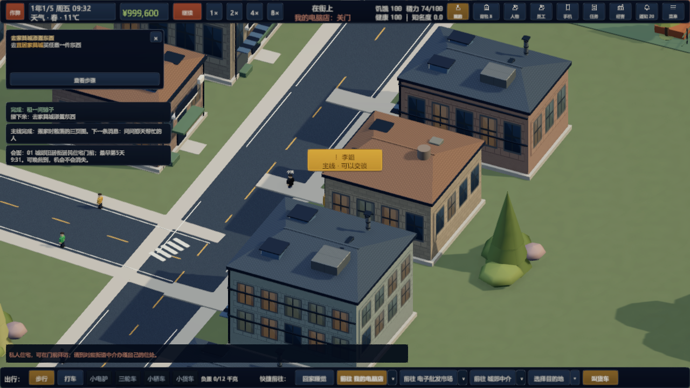

# 当前完整内容、主线与验收归档（2026-11-03）

本篇汇总当前 main 源码与本轮全部交付，替代第51篇作为最新状态入口。第40、46、49、50、51篇保留各自历史；后续规则以本篇和对应最新专题为准。本次同步源码、Unity meta、文档、测试结果与实际游戏截图，不生成新发行包。

> 后续完整状态以[第59篇（2026-11-04）](59-current-game-content-2026-11-04.md)为准。本篇三段18节点为历史执行链；新第二、三段已改为[第58篇](58-mainline-exhibition-and-tender.md)真实展会/竞标连续任务，上市/股价不作为新路线硬门槛。旧链仅按进行中存档兼容保留。

## 1. 当前内容总表

| 系统 | 当前已实现内容 | 详细文档 |
| --- | --- | --- |
| 城市与出行 | 湖城V13，城郊／社区／公园／花园四片区，90个实体地点、1046个道路节点、四家中介、84栋填充住宅；步行、载具、导航、独立家与店内场景；三条跨区通道按主线开放 | [内容总览](10-current-content.md)、[基础快照](40-current-snapshot-2026-11-02.md) |
| 开局与多店 | 出租屋、租铺、按店型教学、装修、独立库存账目、营业时间、开门与实际值守、多店经营 | [第40篇](40-current-snapshot-2026-11-02.md) |
| 电脑 | 配件、科技换代、兼容装机、整机展示和出售 | [店型核心](36-shop-core-gameplay-and-supplier-stock.md) |
| 模型与服装 | 模型系列热度及展会限定；服装应季需求与供给事件；实际采购、陈列及出售 | [店型核心](36-shop-core-gameplay-and-supplier-stock.md) |
| 二手 | 报价收购、卖家循环与性格、风险鉴定、独立成本和转售、收购师代管 | [店型核心](36-shop-core-gameplay-and-supplier-stock.md) |
| 餐馆 | 实际食材、烹饪火候、传菜、用餐付款和收桌；老板手动与员工代管；饮料加购 | [店型核心](36-shop-core-gameplay-and-supplier-stock.md)、[饮料](41-restaurant-drinks.md) |
| 商品与货架 | 实际陈列决定可售商品，件数／承重双上限，后仓分区与不限容量，多纸箱共用本处后仓；最高售价倍率3倍 | [货架](44-shelf-item-capacity.md)、[售价](42-markup-up-to-three.md) |
| 员工与供货 | 多岗位、班次、工资、实际在岗、同岗多人；进货员采购历史；商家＋型号＋星期共享限量，实际运输与费用 | [采购](38-supplier-model-allocation-and-weekdays.md) |
| 商圈与租金 | 每日经过人数、位置和面积影响租金、已签租约保价；40米内同类自营店客流按数量分流 | [经过人数](43-agency-daily-footfall.md)、[商圈](45-local-shop-competition.md) |
| 生活与健康 | 饥饿、精力、健康、晕倒／住院、睡眠、打工、天气换装、住宅家具和衣柜、食品批次、冰箱永久保存 | [生活底座](40-current-snapshot-2026-11-02.md)、[冰箱](35-permanent-fridge-storage.md) |
| 居家工作台 | 经营、投资、联系人、分店远程操作与生活托管；远程查看不算到岗，实体操作仍需到场 | [工作台](37-home-workbench.md) |
| 人物与社交 | 120名正式NPC，住处／工作／兴趣／经历／关系网；当面和手机对话、联系方式、邀约、活动、日程导航和真实服务结算 | [人物档案](47-city-npc-dossiers.md)、[接入说明](49-narrative-content-implementation.md) |
| 主线 | 三段引荐、18个可推进节点、达标三天后主动邀请、真实会面、三人寻物、合作、实物修复交付及道路授权 | 本篇第2—5节、[剧情总纲及执行流程](story-and-district-progression.md) |
| 财务与资产 | 实际账本、现金／经营／生活／资产／融资分类、采购预算、投资、物业与合同；正式品牌上市等仍见第9节边界 | [基础快照](40-current-snapshot-2026-11-02.md)、[UI整理](50-ui-cleanup-excluding-employees.md) |
| 界面与存档 | 经营／采购／物业／行情／人物／日程入口整理，特殊店型页签，保存读取和旧档迁移；主线标识及会面导航 | [UI整理](50-ui-cleanup-excluding-employees.md)、本篇第6—8节 |

五类新开自营店为电脑、模型、服装、二手、餐馆。普通零售混售及旧档资产按既有兼容规则保留。宠物店尚未实现。小／中／大店的8／12／20货架、4／6／10员工上限，采购配额、食品和容量等详细数值仍见对应专题。

## 2. 主线入口、三天邀请与道路

| 晋升 | 首次资格门槛 | 完成的剧情 | 开放结果 |
| --- | --- | --- | --- |
| 城郊→社区 | 5家真实布置营业的城郊店，现金至少100万元 | 小陈委托、李姐介绍三人、三页地图寻回拼合与交付 | 社区道路与经营接洽 |
| 社区→公园 | 6家社区营业店、净资产至少3000万元、自有品牌上市条件 | 社区合作活动、饭局、稀缺展样取得修复交付、共同引荐 | 公园道路与经营接洽 |
| 公园→花园 | 同一行业完整月收入1亿元、对应自有股价100元，进入次月 | 选择实际公园试点店、合作条款、支付和经营履约 | 花园道路与经营接洽，之后可做收束回应 |

门店、资金及实际销售使用正式经营对象。品牌上市、发行人股价、行业完整月收入目前没有完整正式晋升接口，编辑器提供明确的独立验收凭据；正式发行版不接受这些调试凭据，不能据此声称所有数值晋升机制已经完成。

首次达标记录72游戏小时计时，李姐／唐蔚／任帆分别主动联系。弹窗可“查看并回复邀请”，也可稍后通过手机聊天的主线消息回复。重复补条件不重置计时；计时随存档保存，达标后短期支出不撤回邀请。第三段先满足次月条件，再等待三天。

三条跨区道路中段显示路障；手动／自动通行被拦下并提示当前任务。出租车拒绝越区且不收费，地铁同样检查资格。完成对应交付／履约后撤障，不能仅靠远程打开对话解锁。NPC和物流继续使用各自道路。旧档在高区可向低区返回；资格、资产与位置按兼容规则保留。

## 3. 第一段：三人、三箱、三页地图

小陈准备街区介绍会，三页旧街手绘商铺图分开寄存。先在城郊中介接受委托，再预约到旧居街“01 城郊旧居街居民住宅”门前见李姐，了解三位保管人。之后可任意顺序推进。

| 保管人 | 条件 | 线索揭示后的藏点 | 拾取物 |
| --- | --- | --- | --- |
| 李姐 | 好感至少30，接受委托后一起完成青湾郊游 | 旧居街：城郊平地散步公园入口，绿绳箱 | 旧居街图页 |
| 老林 | 好感至少30，接受委托后一起在街坊餐厅聚餐 | 城郊商业街：青湾球场入口，蓝绳箱 | 商业街图页 |
| 周叔 | 好感至少30，接受委托后在老李CPU档口完成旧物闲逛 | 电子批发市场：批发市场站入口，红绳箱 | 批发市场图页 |

“旧物闲逛”为独立休闲服务：看旧收音机、找老唱片、聊评书和听旧事，不要求买货或营业额。必须实际选择对应服务并完成活动；预约后改成其他服务、错误同行者、委托前活动、取消、缺席和中途离场都不算。活动证据可先取得，好感之后补足。

同时满足两项后，再当面或通过已有联系方式向本人选择“打听你保管的旧街图页”。每条线索只生成自己的箱子，初始不生成；三处均在第一道关卡之前。到场走近按F，取得一页后对应箱子隐藏。三页齐全仍不自动完成地图，要在主线窗口点击拼合，再预约回城郊中介交付。交付完整图后才开放社区道路。

线索、活动证据、图页、完整图、交付状态独立保存；重复调查、拼合和交付不能重复奖励。已拿到旧版完整地图的旧档保留交付资格，旧版已解锁社区保留通行；旧版尚未取图的寻物档进入新条件，旧试营业档转入李姐介绍阶段。

## 4. 第二、三段当前执行规则

第二段：活动预算按选择实际支付1000或2000元，现场参与30游戏分钟；饭局160元并参与30分钟；展样转让及修复1800元，等待120分钟后领取实物，实际交付后报销一次；共同引荐开放公园。

第三段：选择已有公园门店作为合作试点；条款选择对应实际支付5000／50000／10000元。签约满一天，约定店铺继续营业且存在签约后的实际销售，再进行履约验收并开放花园。贷款、注资不能冒充销售。尊重袁岚退出的分支由宋棉自愿参与。开放后继续回应后续介绍机会，保留介绍与婉拒的选择。

实际会面按约定地点和时间核验，人物沿路线赴约。弹窗与主线窗口暂停时间，等人、活动计时或等待修复时需关闭窗口。迟到不清空机会。18个节点的具体对白和选择保存在 `DistrictNarrativeCatalog.cs`，执行与存档主要位于 `GameSession.Districts.cs`、`GameSession.CommunitySearch.cs` 和 `DistrictProgress.cs`。

## 5. 编辑器作弊验收

游戏运行后打开“作弊工具”。首页与“三段主线验收”均可访问相关按钮。

1. 三个阶段前置按钮：按顺序补齐门店和资金／验收凭据，仍等待主动邀请，不直接开路；上一段未完成则下一段禁用。
2. 第一段进入三线寻物后，点击“三人寻物：一键满足好感和娱乐条件”。三人好感至少30（已有更高好感保持）、任务娱乐完成标记、通讯录和聊天手机一次补齐。
3. 之后自己分别打听、寻找三个箱子、拼图、预约并交付。

三人按钮不推进时间、不花钱、不伪造真实城市活动历史，不赠送线索、图页或完整图，不改变已有进度或开放道路；允许重复点击，结果可保存读取。它只在李姐介绍完保管人后的寻物阶段可用。作弊功能仅编辑器可用。

## 6. 人物标识与会面导航

当前主线相关人物显示金色“!＋姓名＋状态”，区分待约见、正在赴约、等待会面、可以交谈。人在建筑内时把标识放在入口，注明“在此建筑内”，不改变其真实作息或位置。标识以屏幕视口锚点定位，缩放或切换分辨率时仍跟随场景目标，并显示于建筑遮挡之上。

近处点击标识可交谈，远处点击查看主线。三位保管人各自问出线索后撤下自己的标识；当前主线结束后相关标识消失。主线窗口新增“前往会面地点门前”，通过正常城市行程导航，停在门外，不自动进入私人住宅。

## 7. 人行道与道路连续通行

原湖城多数道路按2画面米半宽限制自由移动，但画出的车行道加两侧铺装更宽，造成隐藏边界卡人。现在道路绘制与移动共用路宽计算，可走范围覆盖整个车行道及两侧各1.4宽铺装。凸起路沿移除，铺装压平，横穿时没有区域切换。路面颜色保留，建筑与庭院仍有外边界，主线关卡仍按资格拦截。

## 8. 睡眠、晕倒及住院的性能

快速推进仍逐分钟模拟世界。主要优化是缓存静止居民的通勤耗时估算，避免每分钟重复构造相同路线。键包括精确位置、目的地和是否室内，上限4096；位置／目的地变更重算，实际出发仍生成真实路线，缓存不写入存档。

同机五店测试中，08:31睡至次日08:00的核心计算从约5.54秒降至0.63秒；恢复路径对照中睡眠约5.79→0.64秒、精力耗尽晕倒约0.86→0.29秒、住院约9.02→1.04秒。三组完整序列化存档结果一致，恢复与费用去重得到验证。另修复活动恰好在关门时结束却被误判中断的问题。

这些是固定种子与存档的核心模拟对照，不等于玩家全部存档的加载／绘制时间保证，也不是新的发行包帧率测量。完整方法、基线失败及原始报告见[性能专题](39-performance-optimization.md)。

## 9. 美术、完成度与待开发边界

main继续使用工业风低多边形场景和当前UI。`art/industrial-reference` 保存工业参考快照，`art/pixel-town` 为独立像素风实验；本次不移动或合并这两个分支。美术截图与概念探索范围见[第51篇历史归档](51-current-state-and-art-branches-2026-11-03.md)。

三段18节点现已可执行；20条关键人物支线仍为内容配置。人物经历、既有社交和作息可使用，不代表这些新支线全部做成任务。正式自有品牌上市、发行人股价及行业完整月账晋升机制仍待开发。此前首段“只会面就开路”“3笔销售／1000元试营业”“家具城单箱完整地图”均已被三人三处寻物替代；对应旧截图和早期报告只保留历史用途。

最新已记录Windows包仍为 `Windows-Optimized-20261102-223752`，不包含全部后续源码。本次不新建Windows包、WebGL包或GitHub Release；按仓库既有忽略规则提交源码与文档材料。

## 10. 验证、截图与后续工作入口

[本次最终组合检查记录](validation/52-current-archive-results.md)记录对最终源码的一次组合测试；原始结果见同目录XML。此前迭代的187、55、48等数量有交叉且对应不同阶段，不能相加当作当前全仓通过数。整个长期测试全集未在本次执行；已知旧约会、配送及旧布局断言问题仍按各历史报告解释。

[累计执行记录](validation/district-progression-results.txt)包含邀请、道路、三线寻物、读档、活动、通勤缓存、连续路面、作弊及标识的迭代范围与失败样本修正。图形冒烟使用正式场景和UI；图形夹具可预置关系／活动条件，正式活动调度、选择服务、耗时与结算由EditMode测试另行覆盖，不声称完整人工通关。

- [李姐主线标识](previews/district-progression/community-meeting-marker.png)
- [三线任务窗口](previews/district-progression/community-search-clue.png)
- [公园图页箱](previews/district-progression/community-fragment-box-0.png)、[球场图页箱](previews/district-progression/community-fragment-box-1.png)、[地铁入口图页箱](previews/district-progression/community-fragment-box-2.png)
- [三页待拼合](previews/district-progression/community-three-pieces.png)、[完整地图](previews/district-progression/community-map-found.png)
- [封路](previews/district-progression/road-closed.png)、[拦截](previews/district-progression/road-stopped.png)、[完成后放行](previews/district-progression/road-open.png)

后续优先根据实际试玩修正寻物指引、交往节奏与三段任务难度，再接入正式金融晋升条件及人物支线。此处是后续方向，不表示本次已经实现。
