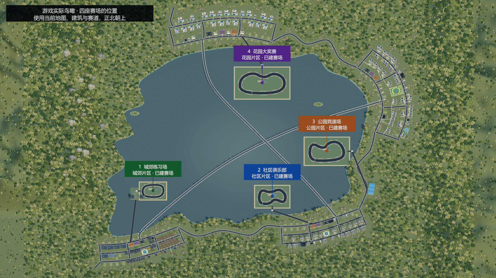

# 当前游戏完整内容归档 2026年11月5日

当前工程是低多边形3D城市生活与多业态经营游戏。玩家从出租屋与一万元起步，经营商店、照顾生活、建立人脉，通过品牌和实际合作开放城郊、社区、公园、花园；新增签约KOL直播、连续四天实体展会、住宅出租产权、湖区赛车和二手车行。

本篇是当前版本总入口，汇总全部系统并链接详细规则。第59篇及更早归档保留历史状态；住宅、展会、人物数量、赛车及主线交付以本篇和对应最新专题为准。第60—70篇中“未提交”描述各次开发结束时的状态，本次统一纳入GitHub归档。旧Windows包不代表当前源码。

## 世界与基础操作

Unity 2022.3.6f1、URP、uGUI，主场景为 `Assets/Scenes/Main.unity`。当前地图JSON有97个显式地点、1051个道路节点、1068条边、10个街区、4家片区中介；运行时另生成住宅地点，不能把97个显式地点理解为97套住宅。四座赛场和两处车辆服务地点是本次新增。

WASD/方向键移动、F就近交互、B背包、M我的、C日程、P手机。步行、地铁、出租车、自有车辆及货运使用实际路线、时间和费用；跨区通行受主线资格约束。暂停、倍速、营业、人物行程、烹饪、采购和生活共享游戏时钟。湖桥保留既有景观和通行规则，赛场道路另接街区；全湖原主路线步行仍为1440游戏分钟。

街道、店内、家中与展厅使用实际3D场景。日历每月30天、每年360天；少数历史长期目标仍保留365天口径。天气、昼夜、人物通勤和匿名行人继续运行。

## 店铺经营与商品

| 系统 | 当前内容 |
| --- | --- |
| 电脑店 | 54款配件、兼容装机、盒装/散件、整机陈列、委托装机、新品迭代和旧代降价 |
| 模型店 | 4个原创系列、12款常规货、周期热度、限定商品及实际到场采购 |
| 服装店 | 24款服装、四档品质、季节和气温影响需求、镜子及销售加成 |
| 二手旧物店 | 循环卖家与真假说辞、报价收购、买后鉴定、逐件定价；高智力收购师代管 |
| 餐馆 | 备料、点单、炒饭火候、出锅、上菜、用餐收款、收桌；厨师和服务员；饮料真实加购 |
| 二手车行 | 社区起可开，按人脉收车、检测整备、挂牌、等待低频买家、实际成交；见赛车部分 |
| 其他委托经营 | 网吧/电竞馆、园区买地改造招商等既有首版经营模板；并非全部拥有手操小游戏 |

花店、生鲜不提供新开专用循环，旧档资产和城市消费地点保留；宠物店尚未制作。普通店可混售实际陈列商品，餐馆和二手保留专用流程。

租铺需实际中介、区域资格、费用与交房时间。小/中/大店最多8/12/20个货架、4/6/10名员工，各店独立库存、装修、班次、采购和配送。普通货架20件/60千克、加固30件/100千克、重型40件/160千克，两种上限同时生效。后仓不限容量，纸箱共用所在处的后仓；运输和陈列仍受容量限制。

中介显示预计每日经过人数，综合地铁、住宅、路程和面积；新挂牌月租按人数×5元，旧租约保价。40米内同类自营店含自己N家，各保留1/N基础客流。经过人数不是成交保证。

普通售价最高参考价3倍，基础购买意愿可以为0；销售员、道具、餐馆饮料和适用品牌效果仍影响成交。餐馆饮料另加20个百分点，但必须实际有货。装修、退租、搬店和关闭前检查资产、库存、订单及人员，不用关窗删除未结业务。

详见[店型](36-shop-core-gameplay-and-supplier-stock.md)、[饮料](41-restaurant-drinks.md)、[定价](42-markup-up-to-three.md)、[客流](43-agency-daily-footfall.md)、[货架](44-shelf-item-capacity.md)、[商圈](45-local-shop-competition.md)。

## 采购与运输

批发限额按“商家＋具体型号＋星期”共享，所有自营门店、进货员安排和自采共同占用，不同商家独立。安排提供每天、周一三五、仅周三；周末批发休息。配置时实时扣除其他有效计划额度，最大采购受额度、预算、运力与起订量共同约束，次日起实际扣款采购。

手机统一网购含家具、摆设、衣服、礼品、大米、电脑配件；配件按市场价85折及适用人物优惠，每单15元运费、次日10点到；生活用品沿原报价及两天配送。旧1788选商家入口撤除，线下多渠道保留，旧已付款单按旧合同承接。

背包优先装货，超重可叫货车；可选家或指定分店收货，按路线和容量运输，在途预留、车辆占用和到货解占存档。采购记录显示实际购买及跳过原因。详见[共享配额](38-supplier-model-allocation-and-weekdays.md)、[统一网购](57-simplified-online-shopping.md)。

## 员工与生活

员工可调收银、装机、进货、销售、厨师、服务员、收购师及待安排；能力随人保留，专用岗位检查店型，真实到岗才提供效果。跨午夜班次、超时加班、日结工资、同岗多人和跨店次日调动保留。玩家还可签一周打工合同，实际到店出勤，按迟到/缺勤结算日薪。员工界面沿此前约定保留。

饥饿、精力、健康、缺觉、晕倒和住院按时钟计算；回家实际到床睡觉。精力归零连续清醒240分钟才疲劳晕倒，睡眠或恢复结束倒计时。食物有批次和剩余期限，冰箱内永久保存，取出继续剩余期限；背包、后仓、运输中的食物正常计时。冰箱四档60/120/240/360千克，多台容量相加。

家中可吃饭、储物、换衣、装修；衣柜试穿和天气换已有衣物不自动买衣。家庭经营大屏28000元，提供总览、经营、投资、联系人，远程经营不等于老板到岗；生活托管实际消耗饭食/现金并保存预算。大屏尚未要求实体安装及靠近F启用。

详见[员工](13-employees-and-procurement.md)、[打工](18-player-work-and-weekly-pay.md)、[冰箱](35-permanent-fridge-storage.md)、[家庭大屏](37-home-workbench.md)。

## 住宅与物业

同一家中介分商铺/住宅页，共用本片区鸟瞰背景、取景、拖动和缩放；切页只换可点选房源，换中介才重置片区。支持定位中介、复位和放大选中房源。

按NPC登记住址判定占用，不把白天不在家当空房。空房可租或买来自住；有NPC住的房子可买出租产权，保留住户并按月收租。可持有多处出租产权，但仅一处玩家自住房；产权出售不赶走NPC，空房不凭空产生租金。

四档月租450/1200/3000/12000元，住宅买卖、2%出租产权交易费、30%按揭首付、36期等额本金、月利率0.4%、月维护房价0.1%按现有规则。租金按住宅计而非按住户人数翻倍；没有独立NPC钱包模拟。家具、食物、储物、旧房贷和自住/出租资产转移承接存档。

第63篇曾统计120名NPC的住址，当前另有4位车友，实际占用始终读取运行档。尚未增加自动招新租户和NPC搬家剧情。详见[住宅产权](63-residential-map-and-tenanted-ownership.md)、[片区取景](68-residential-agency-district-map.md)。

## 人物与主线

当前124名正式NPC，各有稳定ID、正式姓名、住处、工作、兴趣、经历和关系；120名原人物加4名车友。旧昵称作为别名兼容，头像采用复古生活漫画风，4名车友使用新增独立头像。匿名行人与顾客不计入正式人数。人物资料、送礼、联系方式、邀约、爽约、活动和相处记录使用实际状态。

社区澄光传媒可介绍15位直播KOL，实际赴约交换名片，业务认识不赠送私人好感。公园阶段可成立自己的MCN，沿既有90日合同、广告分成和资源支持规则；自办MCN和品牌直播合同是不同业务。

当前第一段：五家城郊营业店、现金100万元达标72小时后李秀兰联系，陈启明安排唐蔚会面；三位保管人的好感与活动提供线索，三处F取图页放入普通背包，集齐后当面交唐蔚开放社区。**不再要求玩家手动拼图。** 后续社区六店、净资产3000万元及品牌衔接参展履约；公园行业上个完整月营业额1亿元衔接企业竞标及三期交付，再开放花园。睡眠中到期邀请延至醒来后两小时。

住宅门口可查看住户，在家且好感达到60可入内交流。固定作息检查营业、休息日、空铺；餐厅支持全天用餐。旧已解锁道路、进行中合作及旧格式合同保留。

20条重点人物长期支线并非全部可通关长剧情；部分KOL样品、复盘、参展和引荐短故事已接实际记录。详见[人物档案](47-city-npc-dossiers.md)、[最新主线交付与作息](60-mainline-residences-and-business-hours.md)、[品牌主线](58-mainline-exhibition-and-tender.md)、[4位车友](69-lake-racing-and-used-car-shops.md)。

## 品牌与KOL直播

社区阶段右上角出现品牌入口，电脑/模型/服装品牌沿真实门店、经营时长与收入条件创立；知名度不是单纯付款解锁。基础、中级、高级品牌可签3/7/12位直播KOL，中级需影响力100及2万元，高级需影响力300及10万元。

KOL市场展示头像、魅力、智力、粉丝、人气及费用。签90日独家直播合同，一次签约费加动态日薪；日薪为200＋粉丝/100取整＋人气×5元，按已签分钟折算、每日结算，暂停直播仍计工资。粉丝增长会提高工资。MCN介绍与已有联系方式规则阻止跳过认识环节。

每人独立排班，15分钟至12小时、支持跨午夜，默认18点至次日2点；工作、赶路、活动及展会占用会停播。直播间展示头像、真实现货、模拟讲解/弹幕、在线观众及本场数据。魅力影响观众和客流，智力提高购买意愿；同品牌合计客流加成最高90%、购买意愿最高20个百分点，实际成交仍需库存和服务。

10/100/1000元礼物真实扣款，15游戏分钟冷却，增加暂时观众、粉丝及人气，并按概率提升品牌影响力。直播并非真人视频，也不凭观看窗口直接生成收入。原7日推广、90日代言、独家冲突与营业额分成继续独立结算。详见[直播完整规则](64-brand-kol-livestreams.md)、[动态工资](65-quarterly-expo-and-kol-payroll.md)。

## 季度展会与企业合作

品牌成立后在品牌→展会筹备。每90天一次，第75/165/255/345天开幕，连续4天，每日9—17点，展前7天截止。会展中心不再接受整栋租购；既有资产不擅自删除。

| 摊位 | 展品 | 签约KOL至少 | 4天摊位费 | 海报 |
| --- | --- | --- | --- | --- |
| 小 | 1—2种，每种100件 | 1名 | 5000元 | 不强制 |
| 中 | 4—5种，每种100件 | 5名 | 20000元 | 3000元、24小时 |
| 大 | 6—8种，每种100件 | 8名 | 60000元 | 8000元、24小时 |

报名转移实际库存，KOL必须属于本品牌且合同覆盖闭展；海报需向已认识的创作者委托。站台每日总报价为报名时日薪3/4/5倍，包含基础日薪，另扣差额避免双算。实际到会展中心，人员到齐后报到；连续4天锁定普通出行，夜间安排休息，后台经营照常结算，可中途保存。

真实3D展厅显示摊位、对应品类展品、余量、海报、真实KOL、舞台和观众；可点选区域、旋转缩放、查看近景。每天6段事件和舞台互动，共24段，围绕排队、采访、故障、采购、质疑等三选一判断。销量、信任、热度和费用受选择影响，余货闭展退回，随后订单需实际库存配送。不包含自由演讲动作或QTE；原一天三轮已付款旧展会仅走兼容流程。

企业年度竞标、公园实际调查、10件试单、评审、同一合同三期各30件交付及花园90日机构资源保留。对手是规则驱动的具名公司，并非全城自主财务模拟。详见[季度规则](65-quarterly-expo-and-kol-payroll.md)、[现场操作](66-expo-scene-and-onsite-interaction.md)、[企业业务](54-brand-expo-tender-playable.md)。

## 赛车与二手车行

买第一辆小电驴即可开始；旧档有车也可迁移参赛。顺丰车行出售5款电驴及2款三轮，顺丰改车只改电驴，湖岸汽车城出售8款四轮车型并整备三轮/四轮；共15款，价格1800至380万元。车库每台车有独立编号、车况、动力、极速、抓地和操控。

四座实体湖区赛场由低到高：城郊练习场、社区俱乐部、公园竞速场、花园大奖赛。正赛需片区和0/1/3/6胜场，报名100/500/2500/10000元，每场2/2/3/3圈；每个场地都有电驴、三轮、四轮组，免费计时练习与玩家加两名对手的竞速。

W/S加速刹车倒车、A/D转向、空格手刹、R复位罚5秒、Tab跟车/全景、Esc暂停。检查点需按顺序，按实际过线排名；碰撞损伤可能受伤，参赛需健康40、精力30、车况40%。固定60Hz街机驾驶期间城市暂停，结束推进30游戏分钟结算。比赛中不能普通存档，结算后自动保存。

四类改装各3级，每级30分钟，动力每级加速+13%、传动极速+7%、轮胎抓地+8、悬挂操控+8；每级费用为基础车价×12%×新等级＋100元。运输占用、扣押、维修、回收和旧载具数量迁移有相应检查。

许星澜、沈知夏、陆景行、顾若宁是4位车友。认识后各每周提供一条车源，关系影响价格。社区二手车行投入8万元及实际租约、周转金，小中大2/4/6展位，店员日薪180元。现场收车或调入自有四轮车，检测300元/30分钟、整备60分钟，再定价挂牌；每3天最多一次概率买家，报价保留2天，实际到店接受才扣车收款。库存可撤回车库，有库存不能关店；不生成旧模板的虚拟日营业额。

赛场、设施和入口道路已经建入实际世界；草坪遮挡和登岸缝隙已修正。当前岛岸为规则底座，绿化和自然岛岸仍未达到概念图精细程度。驾驶是街机模型，非拟真轮胎/联网竞速。详见[全部车型、费用及驾驶规则](69-lake-racing-and-used-car-shops.md)、[实际场景检查](70-racing-actual-map-review.md)。

## 财务 存档 性能与验收

现金、日周月账本、行情、贷款、押金、租金、按揭、投资估值及来源门店归属保留，现金变化不冒充利润。品牌合同、直播排班与工资水位、展会库存和事件、住宅产权和月租、车库改装与成绩、车源购买和车行报价均存档，旧档按缺字段迁移，不重复发货或扣款。

树林分块、柜台控件复用、隐藏世界减少可视更新、人物分钟缓存和静止通勤耗时缓存保留。直播按分钟缓存效果、展厅观众复用并按变化更新，赛场驾驶时不同时跑城市经营。历史性能数字见[第39篇](39-performance-optimization.md)，不是本次重新测量的帧率承诺。

编辑器作弊页提供独立品牌/展会、KOL、赛车验收档及原进度返回。展会档准备城郊5店、社区1店、实际库存设施员工及社区住处，现金150万元；赛车档准备6辆车、500万元、四区、6胜场、4名车友及真实二手车行。正式发行玩家不会自动获赠这些条件。详见[展会验收](67-expo-acceptance-business-base.md)。

本次联合回归记录见[归档验证](validation/71-current-archive-results.md)，原各次报告保留。实际鸟瞰已经检查，赛车手感、展厅视觉及长期经营平衡仍需真人试玩；已知旧员工测试失败不宣称解决。源码与资源文件清单见[SHA-256清单](snapshot-2026-11-05-files.json)。

## 尚未完成与发行范围

宠物店、完整NPC公司财务与自主竞争、企业IPO和自有股票、完整长篇人物支线、住宅扩容及大屏实体安装、全面多语言、Steamworks与正式发行仍未完成。岛岸景观、驾驶手感及经济平衡还需完善；展会事件已接场景，但尚无自由表演小游戏。

本次上传当前工程代码、资源、Unity引用文件、文档、已有预览和验证报告。Unity缓存、临时工作目录、玩家存档、构建包不入库。最新既有Windows包仍是 `Windows-Optimized-20261102-223752`；本次没有重新打包或发布GitHub Release。
