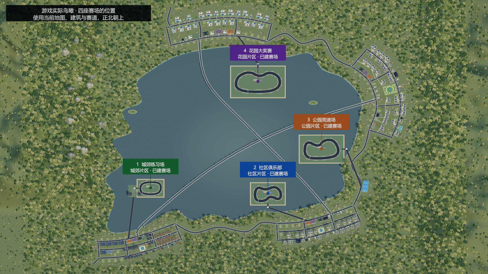

# 当前游戏完整内容归档（2026年11月5日）

> 历史归档：当前全部内容请看[第77篇](77-current-game-content-2026-11-06.md)。本篇保留11月5日的双合约与旧界面说明，已被第73、75、76篇更新。

PCShopSell 是低多边形 3D 城市生活与多业态经营游戏。玩家从出租屋和一万元起步，经营店铺、照顾生活、结交 NPC，通过三段主线逐步开放社区、公园、花园。本篇汇总当前可玩的系统、入口、关键规则和验证结果。

本版更新了品牌总览与门店账目、改名、推广签约流程、手机直播和品牌下播结算、展会筹备与代言人到场，以及多住所睡眠快捷前往。[第71篇](71-current-game-content-2026-11-05.md)及更早文档保留各次交付时的规则和验证。以下为当前规则。

## 世界与基础操作

Unity 2022.3.6f1、URP、uGUI，主场景为 `Assets/Scenes/Main.unity`。当前地图JSON有97个显式地点、1051个道路节点、1068条边、10个街区、4家片区中介；运行时另生成住宅地点，不能把97个显式地点理解为97套住宅。地图包含四座赛场和两处车辆服务地点。

WASD/方向键移动、F就近交互、B背包、M我的、C日程、P手机。步行、地铁、出租车、自有车辆及货运使用实际路线、时间和费用；跨区通行受主线资格约束。暂停、倍速、营业、人物行程、烹饪、采购和生活共享游戏时钟。湖桥保留既有景观和通行规则，赛场道路另接街区；全湖原主路线步行仍为1440游戏分钟。

街道、店内、家中与展厅使用实际3D场景。日历每月30天、每年360天；少数历史长期目标仍保留365天口径。天气、昼夜、人物通勤和匿名行人继续运行。

## 店铺经营与商品

| 系统 | 当前内容 |
| --- | --- |
| 电脑店 | 54款配件、兼容装机、盒装/散件、整机陈列、委托装机、新品迭代和旧代降价 |
| 模型店 | 4个原创系列、12款常规货、周期热度、限定商品及实际到场采购 |
| 服装店 | 24款服装、四档品质、季节和气温影响需求、镜子及销售加成 |
| 二手旧物店 | 循环卖家与真假说辞、报价收购、买后鉴定、逐件定价；高智力收购师代管 |
| 餐馆 | 备料、点单、炒饭火候、出锅、上菜、用餐收款、收桌；厨师和服务员；饮料真实加购 |
| 二手车行 | 社区起可开，按人脉收车、检测整备、挂牌、等待低频买家、实际成交；见赛车部分 |
| 其他委托经营 | 网吧/电竞馆、园区买地改造招商等既有首版经营模板；并非全部拥有手操小游戏 |

花店、生鲜不提供新开专用循环，旧档资产和城市消费地点保留；宠物店尚未制作。普通店可混售实际陈列商品，餐馆和二手保留专用流程。

租铺需实际中介、区域资格、费用与交房时间。小/中/大店最多8/12/20个货架、4/6/10名员工，各店独立库存、装修、班次、采购和配送。普通货架20件/60千克、加固30件/100千克、重型40件/160千克，两种上限同时生效。后仓不限容量，纸箱共用所在处的后仓；运输和陈列仍受容量限制。

中介显示预计每日经过人数，综合地铁、住宅、路程和面积；新挂牌月租按人数×5元，旧租约保价。40米内同类自营店含自己N家，各保留1/N基础客流。经过人数不是成交保证。

普通售价最高参考价3倍，基础购买意愿可以为0；销售员、道具、餐馆饮料和适用品牌效果仍影响成交。餐馆饮料另加20个百分点，但必须实际有货。装修、退租、搬店和关闭前检查资产、库存、订单及人员，不用关窗删除未结业务。

详见[店型](36-shop-core-gameplay-and-supplier-stock.md)、[饮料](41-restaurant-drinks.md)、[定价](42-markup-up-to-three.md)、[客流](43-agency-daily-footfall.md)、[货架](44-shelf-item-capacity.md)、[商圈](45-local-shop-competition.md)。

## 采购与运输

批发限额按“商家＋具体型号＋星期”共享，所有自营门店、进货员安排和自采共同占用，不同商家独立。安排提供每天、周一三五、仅周三；周末批发休息。配置时实时扣除其他有效计划额度，最大采购受额度、预算、运力与起订量共同约束，次日起实际扣款采购。

手机统一网购含家具、摆设、衣服、礼品、大米、电脑配件；配件按市场价85折及适用人物优惠，每单15元运费、次日10点到；生活用品沿原报价及两天配送。旧1788选商家入口撤除，线下多渠道保留，旧已付款单按旧合同承接。

背包优先装货，超重可叫货车；可选家或指定分店收货，按路线和容量运输，在途预留、车辆占用和到货解占存档。采购记录显示实际购买及跳过原因。详见[共享配额](38-supplier-model-allocation-and-weekdays.md)、[统一网购](57-simplified-online-shopping.md)。

## 员工与生活

员工可调收银、装机、进货、销售、厨师、服务员、收购师及待安排；能力随人保留，专用岗位检查店型，真实到岗才提供效果。跨午夜班次、超时加班、日结工资、同岗多人和跨店次日调动保留。玩家还可签一周打工合同，实际到店出勤，按迟到/缺勤结算日薪。员工界面沿此前约定保留。

饥饿、精力、健康、缺觉、晕倒和住院按时钟计算；回家实际到床睡觉。精力归零连续清醒240分钟才疲劳晕倒，睡眠或恢复结束倒计时。食物有批次和剩余期限，冰箱内永久保存，取出继续剩余期限；背包、后仓、运输中的食物正常计时。冰箱四档60/120/240/360千克，多台容量相加。

家中可吃饭、储物、换衣、装修；衣柜试穿和天气换已有衣物不自动买衣。家庭经营大屏28000元，提供总览、经营、投资、联系人，远程经营不等于老板到岗；生活托管实际消耗饭食/现金并保存预算。大屏尚未要求实体安装及靠近F启用。

详见[员工](13-employees-and-procurement.md)、[打工](18-player-work-and-weekly-pay.md)、[冰箱](35-permanent-fridge-storage.md)、[家庭大屏](37-home-workbench.md)。

## 住宅与物业

同一家中介分商铺/住宅页，共用本片区鸟瞰背景、取景、拖动和缩放；切页只换可点选房源，换中介才重置片区。支持定位中介、复位和放大选中房源。

按NPC登记住址判定占用，不把白天不在家当空房。空房可租或买来自住；有NPC住的房子可买出租产权，保留住户并按月收租。可持有多处住宅与出租产权，其中一处为主住所。出售出租产权时保留原住户，空房不产生租金。

四档月租450/1200/3000/12000元，住宅买卖、2%出租产权交易费、30%按揭首付、36期等额本金、月利率0.4%、月维护房价0.1%按现有规则。租金按住宅计而非按住户人数翻倍；没有独立NPC钱包模拟。家具、食物、储物、旧房贷和自住/出租资产转移承接存档。

底栏住宅快捷按钮默认指向主住所。有多处可入住的住宅时，点旁边小三角选择地址，按钮会换成“前往 住所名”。再点主按钮才出发，按实际路线进屋、走到床边，再打开常规睡眠面板。可选主住所及本人持有、可通行的空房。选择的快捷目的地会存档，房源失效时回到主住所。临时住宿沿用当前住宅的气候和睡眠规则，家具、储物及主住所身份按各自原归属保留。

住宅门口按 F 可看真实住户及在家状态，点头像可看资料。与至少一位在家的住户好感达到 60，可进入实体室内，走到住户身边再交谈。街景用浅蓝色的边框和半透明面标识玩家住宅。

第63篇曾统计120名NPC的住址，当前另有4位车友，实际占用始终读取运行档。尚未增加自动招新租户和NPC搬家剧情。详见[住宅产权](63-residential-map-and-tenanted-ownership.md)、[片区取景](68-residential-agency-district-map.md)。

## 人物与主线

当前124名正式NPC，各有稳定ID、正式姓名、住处、工作、兴趣、经历和关系；120名原人物加4名车友。旧昵称作为别名兼容，头像采用复古生活漫画风，4名车友使用新增独立头像。匿名行人与顾客不计入正式人数。人物资料、送礼、联系方式、邀约、爽约、活动和相处记录使用实际状态。

可通过社区 MCN 接待预约认识创作者，实际赴约交换业务名片。公园阶段可成立自己的MCN，沿既有90日合同、广告分成和资源支持规则；自办MCN和品牌直播合同是不同业务。

三段主线随经营进度开放相邻片区。五家城郊营业店、现金 100 万元达标 72 小时后，李秀兰发来第一段消息。睡眠中到期的邀请延至醒来后两小时。

回复李秀兰后，按当前提示找到陈启明，请他安排唐蔚在城郊街边见面。按显示的日期、时间和地点赴约，由唐蔚本人交代寻物。李秀兰介绍三位保管人后，分别用日常对话和邀约系统，和李秀兰去青湾郊游、和林远航吃家常饭、和周维成逛旧物。满足关系和活动条件后，对应线索接在活动结算后，藏箱随之出现。现场按 F 找到的三张图页各占普通背包一格。集齐后在城郊当面直接把三页交给唐蔚，开放社区道路。

后续以社区六店、净资产 3000 万元及品牌衔接参展履约，再开放公园。公园行业上个完整月营业额 1 亿元衔接企业竞标及三期交付，再开放花园。任务页显示当前人物、会面时间、地点和阶段性的导航。人物对话、找箱与交付在实际场景中完成。

NPC 的工作和日常到访检查营业时间、休息日和空铺。街坊餐厅全天营业。旧已解锁道路、进行中合作及旧格式合同保留。

20条重点人物长期支线处于不同完成阶段，主线引荐和日常人物交互可从实际场景进行。详见[人物档案](47-city-npc-dossiers.md)、[最新主线交付与作息](60-mainline-residences-and-business-hours.md)、[品牌主线](58-mainline-exhibition-and-tender.md)、[4位车友](69-lake-racing-and-used-car-shops.md)。

## 品牌经营与推广

右上角“品牌”从开局就能打开，有“品牌总览、推广与代言、展会、企业竞标、KOL直播”五页。“经营”独立保留门店收支、采购、物业、投资及合同与合作。旧版品牌页的机构资源和人物故事入口已撤下。

### 创立、总览与改名

在“品牌总览”点击“＋ 创建品牌”才展开名称、实惠/品质定位和行业资格。完成第一段主线开放社区后，电脑店、服装店、模型手办店每个行业可创立一个品牌。需要至少 5 家已布置的同业门店，包含至少 3 家城郊店和 2 家社区店；城郊近 30 日营收连续 14 天达到同行基准，社区持续经营满 30 天。达标可直接创建。

每个品牌卡显示旗下门店数、近 7 天营收和经营支出、知名度、口碑、有效代言与短期推广。日期包含当天，展开门店可看单店近 7 天营收、支出等数据并管理归属。品牌共同支出计入品牌总数一次。口碑显示实际分数，存档字段 `Influence` 对应品牌知名度。

品牌卡可改名，新名称须为 2–16 个字符。确认页显示改名前后的数值。每次成功改名，口碑和知名度各减半，向下取整，既有门店归属和合同继续使用同一品牌。

### 推广与代言

“推广与代言”先选品牌，再看近 7 天实际到店人次、当前推广客流加成，以及正在合作的人。每项合作显示头像、期限、费用、加成和合同入口。实际客流计入已经进店的顾客，涵盖各来客来源，从有记录的日期开始累计。加成作用于到店概率，按品牌客流上限折算后分摊到各合作。

在品牌层级的“新增品牌合作”中选择“请代言人”或“发起短期推广”，然后再挑已认识的候选人，或选 MCN 安排认识。澄光传媒偏数码，衣见文化偏服装与生活方式，玩界工作室偏模型收藏，共用社区实际接待地点。合作签署仍检查名片和独家冲突。短期推广 7 天，代言 90 天，代言合同另按适用营业额计 2% 分成。

## KOL 排班与手机直播

| 入口 | 可进行的操作 |
| --- | --- |
| 品牌 → KOL直播 → KOL市场 | 看头像、粉丝、人气、费用，认识后签约 |
| 品牌 → KOL直播 → 主播与排班 | 选品牌及已签主播，安排每天、隔天或每周为品牌播一次 |
| 品牌 → KOL直播 → 专场记录 | 查该品牌的场次、观看统计和下播结算 |
| 手机 → 应用商店 → 街坊直播 | 免费安装后，从手机打开直播大厅、关注主播、进房观看及送礼 |

“品牌专场”就是主播在约定时段为某个品牌做一场直播。玩家给签约主播安排所选品牌，无需指定商品。首次日期、起止时刻可选，按 15 分钟间隔排班，每场 15 分钟至 12 小时，可跨午夜。主播按各自错开的晚间时段开个人直播，实际工作、赶路、活动、展会等可能占用时段。少数未签主播周五也会给竞争品牌直播。大厅列出 15 位主播的头像，在播亮显、下线灰显，可查看下一场预计时间。

初级、中级、高级品牌可签 3/7/12 位主播。升级分别要求知名度 100/300 和 2万/10万元。直播签约期限 90 天，付签约费和动态日薪。日薪为 200 元＋粉丝数除以 100 向下取整＋人气乘 5 元，按实际签约分钟折算。暂停排班期间仍按合同计工资。

直播间共用电脑、服装和模型三个品类的布景，每类有直播台与演示两张图，配合真实 NPC 头像、开场、讲解、演示和问答。预设弹幕根据主播风评、当前阶段、品牌口碑和知名度变化。玩家可以关注、用预设问题参与，或送 10/100/1000 元礼物，每个直播间间隔 15 游戏分钟。礼物增加主播人气、粉丝和短时间的在线观众，可在个人场、自己品牌场或竞争品牌场送出。直播间观看时游戏时间继续推进。

品牌场至少播满 15 游戏分钟才获得结算。下播后一次性更新品牌知名度和口碑，结算页对自己的品牌和竞争品牌都显示品牌名、两个指标的前值、后值和增减。个人场展示本场直播数据。同品牌过去 7 天已完成的专场越多，后续单场收益越小。结算也考虑实际开播时长、观众及主播与品类的适配。旧记录按存档迁移，已结算场次不会重复发放。

直播改变的知名度和口碑是长期数值，通过日常来客计算影响玩家同品类的自营门店。当前客流基础调整为 `min(15%, 知名度 × 0.1%) + (口碑 − 50) × 0.2%`，再合并适用的推广等效果，品牌总调整限制在 −30% 到 ＋60%。观众人数和礼物金额各自记录。竞争品牌保存自己的直播口碑和知名度变化。旧直播版的规则见[第64篇历史记录](64-brand-kol-livestreams.md)。

## 季度展会与企业合作

品牌成立后在“品牌 → 展会”查看本季度筹备总览，分步选摊位、库存门店、展品、站台主播和海报。总览显示日期、费用、准备进度、下一步和往届记录。每90天一次，第75/165/255/345天开幕，连续4天，每日9—17点，展前7天截止。会展中心不再接受整栋租购；既有资产不擅自删除。

| 摊位 | 展品 | 签约KOL至少 | 4天摊位费 | 海报 |
| --- | --- | --- | --- | --- |
| 小 | 1—2种，每种100件 | 1名 | 5000元 | 不强制 |
| 中 | 4—5种，每种100件 | 5名 | 20000元 | 3000元、24小时 |
| 大 | 6—8种，每种100件 | 8名 | 60000元 | 8000元、24小时 |

报名转移实际库存，KOL必须属于本品牌且合同覆盖闭展；海报需向已认识的创作者委托。站台每日总报价为报名时日薪3/4/5倍，包含基础日薪，另扣差额避免双算。实际到会展中心，在展位要求的站台主播到齐后报到；连续4天锁定普通出行，夜间安排休息，后台经营照常结算，可中途保存。

真实3D展厅显示摊位、对应品类展品、余量、海报、真实KOL、舞台和观众；可点选区域、旋转缩放、查看近景。每天6段事件和舞台互动，共24段，围绕排队、采访、故障、采购、质疑等三选一判断。销量、信任、热度和费用受选择影响，余货闭展退回，随后订单需实际库存配送。不包含自由演讲动作或QTE；原一天三轮已付款旧展会仅走兼容流程。

开幕日，有效且覆盖当日的品牌代言人自动随品牌参展，使用同一套 NPC 路线到会展中心。筹备人员页和现场面板显示头像、姓名和位置状态，点击可聚焦现场人物。同时担任站台主播的同一 NPC 只出现一次。开幕日下午的舞台环节可让到场的代言人介绍品牌，玩家可选择介绍、问答或演示方向，结果进入当届展会的信任和热度。代言人免另行邀约与收费，展会报到仍按原有的站台主播要求。

企业年度竞标、公园实际调查、10件试单、评审、同一合同三期各30件交付及花园90日机构资源保留。对手是规则驱动的具名公司，并非全城自主财务模拟。详见[季度规则](65-quarterly-expo-and-kol-payroll.md)、[现场操作](66-expo-scene-and-onsite-interaction.md)、[企业业务](54-brand-expo-tender-playable.md)。

## 赛车与二手车行

买第一辆小电驴即可开始；旧档有车也可迁移参赛。顺丰车行出售5款电驴及2款三轮，顺丰改车只改电驴，湖岸汽车城出售8款四轮车型并整备三轮/四轮；共15款，价格1800至380万元。车库每台车有独立编号、车况、动力、极速、抓地和操控。

四座实体湖区赛场由低到高：城郊练习场、社区俱乐部、公园竞速场、花园大奖赛。正赛需片区和0/1/3/6胜场，报名100/500/2500/10000元，每场2/2/3/3圈；每个场地都有电驴、三轮、四轮组，免费计时练习与玩家加两名对手的竞速。

W/S加速刹车倒车、A/D转向、空格手刹、R复位罚5秒、Tab跟车/全景、Esc暂停。检查点需按顺序，按实际过线排名；碰撞损伤可能受伤，免费练习和正赛都要求健康至少40、精力至少30、车况至少40%。练习场显示实际数值和欠缺项。固定60Hz街机驾驶期间城市暂停，结束推进30游戏分钟结算。比赛中不能普通存档，结算后自动保存。

四类改装各3级，每级30分钟，动力每级加速+13%、传动极速+7%、轮胎抓地+8、悬挂操控+8；每级费用为基础车价×12%×新等级＋100元。运输占用、扣押、维修、回收和旧载具数量迁移有相应检查。

许星澜、沈知夏、陆景行、顾若宁是4位车友。认识后各每周提供一条车源，关系影响价格。社区二手车行投入8万元及实际租约、周转金，小中大2/4/6展位，店员日薪180元。现场收车或调入自有四轮车，检测300元/30分钟、整备60分钟，再定价挂牌；每3天最多一次概率买家，报价保留2天，实际到店接受才扣车收款。库存可撤回车库，有库存不能关店；不生成旧模板的虚拟日营业额。

赛场、设施和入口道路已经建入实际世界；草坪遮挡和登岸缝隙已修正。当前岛岸为规则底座，绿化和自然岛岸仍未达到概念图精细程度。驾驶是街机模型，非拟真轮胎/联网竞速。详见[全部车型、费用及驾驶规则](69-lake-racing-and-used-car-shops.md)、[实际场景检查](70-racing-actual-map-review.md)。

## 财务 存档 性能与验收

现金、日周月账本、行情、贷款、押金、租金、按揭、投资估值及来源门店归属保留，现金变化不冒充利润。品牌合同、直播排班与工资水位、展会库存和事件、住宅产权和月租、车库改装与成绩、车源购买和车行报价均存档，旧档按缺字段迁移，不重复发货或扣款。

树林分块、柜台控件复用、隐藏世界减少可视更新、人物分钟缓存和静止通勤耗时缓存保留。直播会话按游戏分钟推进，展厅观众复用并按变化更新，赛场驾驶时暂停城市经营。启动 HUD 时先建立控件，依赖存档的状态在游戏会话初始化后刷新。历史性能数字见[第39篇](39-performance-optimization.md)，不是本次重新测量的帧率承诺。

编辑器作弊页提供独立品牌、展会、KOL、赛车验收档及原进度返回。“社区资格与品牌展会验收”里的双品牌和三品牌档备好真实门店与经营记录，分别可创立电脑＋服装、电脑＋服装＋模型手办，进入后仍由玩家填写名称、选择定位并手动创建。三段主线的前置条件和三人寻物的关系、娱乐条件可用对应作弊按钮准备。展会档准备城郊5店、社区1店、实际库存设施员工及社区住处，现金150万元；赛车档准备6辆车、500万元、四区、6胜场、4名车友及真实二手车行。正式发行玩家不会自动获赠这些条件。详见[展会验收](67-expo-acceptance-business-base.md)。

本版共通过 153 项 Unity EditMode 检查，包含品牌、直播、展会、住宅等系统的 127 项联合检查和赛车专项的 26 项检查。详见[本版验证结果](validation/72-current-archive-results.md)和[上一版全局归档检查](validation/71-current-archive-results.md)。

## 尚未完成与发行范围

宠物店、完整NPC公司财务与自主竞争、企业IPO和自有股票、完整长篇人物支线、住宅扩容及大屏实体安装、全面多语言、Steamworks与正式发行仍未完成。岛岸景观、驾驶手感及经济平衡还需完善；展会事件已接场景，但尚无自由表演小游戏。

本次归档包含当前代码、资源、Unity .meta、文档和已有预览。Unity缓存、临时工作目录、玩家存档、构建包不入库。最新既有Windows包仍是 `Windows-Optimized-20261102-223752`；本次没有重新打包或发布GitHub Release。
