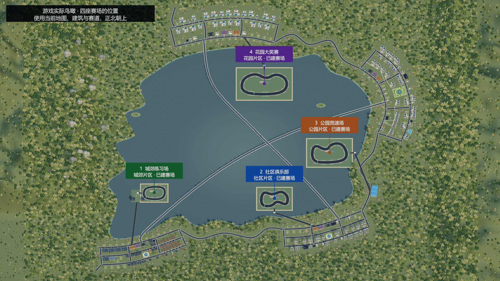

# 当前游戏完整内容归档（2026年11月7日）

本篇是本次上传的统一内容入口，覆盖城市与生活、全部店型、采购与员工、人物与主线、品牌与直播、实体展会、资产与房产行情、公共车库、赛车及二手车行。以当前工程实现为准；旧专题中的费用、入口和“尚未上传”是当时的历史状态。

本轮重点：资产三页与连续物业地图、真实七日收支来源、手机月历与最近七项安排、多品牌联合参展与自动选择、展会居中结算、全款购房与周行情、四区公共车库内租购不限量车位、固定1倍赛车与鼠标右键镜头、每周一大赛和每三天小赛、10名对手、员工进货专用货车。

当前为 Unity 源码工程归档，非新版 Windows 安装包。最新代码已通过 Unity 2022.3.6f1 编译；本次不运行游戏、不截图、不执行测试套件。完整源码与资源索引见[文件清单](snapshot-2026-11-07-r88-files.json)，验证范围见[归档记录](validation/88-current-archive-results.md)。

## 世界与基础操作

Unity 2022.3.6f1、URP、uGUI，主场景为 `Assets/Scenes/Main.unity`。当前地图JSON有103个显式地点、1051个道路节点、1068条边、10个街区、4家片区中介；运行时另生成住宅地点，不能把103个显式地点理解为103套住宅。地图包含四座赛场、四座旁置公共车库和两处车辆服务地点。

WASD/方向键移动、F就近交互、B背包、M我的、C日程、P手机。步行、地铁、出租车、自有车辆及货运使用实际路线、时间和费用；跨区通行受主线资格约束。暂停、倍速、营业、人物行程、烹饪、采购和生活共享游戏时钟。湖桥保留既有景观和通行规则，赛场道路另接街区；全湖原主路线步行仍为1440游戏分钟。

实际道路铺装已统一裁剪重叠：路口、弯道只保留共同车道表面，人行道减去车道区域，门前步道接到人行道外缘，赛场接入路移除重复路堤表面。标线与斑马线按真实道路方向布置；建筑、住宅、赛场位置与寻路节点保持原数据。几何只在场景构建时生成，不逐帧裁剪。详见[道路实现与既有实景对照](74-continuous-roads-and-pavements.md)。

街道、店内、家中与展厅使用实际3D场景。日历每月30天、每年360天；少数历史长期目标仍保留365天口径。天气、昼夜、人物通勤和匿名行人继续运行。

## 店铺经营与商品

| 系统 | 当前内容 |
| --- | --- |
| 电脑店 | 54款配件、兼容装机、盒装/散件、整机陈列、委托装机、新品迭代和旧代降价 |
| 模型店 | 4个原创系列、12款常规货、周期热度、限定商品及实际到场采购 |
| 服装店 | 24款服装、四档品质、季节和气温影响需求、镜子及销售加成 |
| 二手旧物店 | 循环卖家与真假说辞、报价收购、买后鉴定、逐件定价；高智力收购师代管 |
| 餐馆 | 备料、点单、炒饭火候、出锅、上菜、用餐收款、收桌；厨师和服务员；饮料真实加购 |
| 二手车行 | 社区起可开，按人脉收车、检测整备、挂牌、等待低频买家、实际成交；见赛车部分 |
| 其他委托经营 | 网吧/电竞馆、园区买地改造招商等既有首版经营模板；并非全部拥有手操小游戏 |

花店、生鲜不提供新开专用循环，旧档资产和城市消费地点保留；宠物店尚未制作。普通店可混售实际陈列商品，餐馆和二手保留专用流程。

租铺需实际中介、区域资格、费用与交房时间。小/中/大店最多8/12/20个货架、4/6/10名员工，各店独立库存、装修、班次、采购和配送。普通货架20件/60千克、加固30件/100千克、重型40件/160千克，两种上限同时生效。后仓不限容量，纸箱共用所在处的后仓；运输和陈列仍受容量限制。

中介显示预计每日经过人数，综合地铁、住宅、路程和面积；商铺基准月租按人数×5元，实际新租报价再乘每周租金行情，旧租约保价。40米内同类自营店含自己N家，各保留1/N基础客流。经过人数不是成交保证。

商用房源要求地点为允许交易的普通铺面。MCN、中介、会展中心、专用场馆、商城、手机店、农贸市场、餐饮服务点、药店、烟草店、社区及企业服务点、设计场所，以及指定电脑配件、服装、模型零售或批发地点保留原用途。挂牌、租购、拍卖和自营经营验收档共享准入规则；旧档中尚未交房的受保护地点订单取消并退还预付租金、押金。社区商业街补入两间普通商铺以提供可交易的经营空间。

普通售价最高参考价3倍，基础购买意愿可以为0；销售员、道具、餐馆饮料和适用品牌效果仍影响成交。餐馆饮料另加20个百分点，但必须实际有货。装修、退租、搬店和关闭前检查资产、库存、订单及人员，不用关窗删除未结业务。

详见[店型](36-shop-core-gameplay-and-supplier-stock.md)、[饮料](41-restaurant-drinks.md)、[定价](42-markup-up-to-three.md)、[客流](43-agency-daily-footfall.md)、[货架](44-shelf-item-capacity.md)、[商圈](45-local-shop-competition.md)。

## 采购与运输

批发限额按“商家＋具体型号＋星期”共享，所有自营门店、进货员安排和自采共同占用，不同商家独立。安排提供每天、周一三五、仅周三；周末批发休息。配置时实时扣除其他有效计划额度，最大采购受额度、预算、运力与起订量共同约束，次日起实际扣款采购。

手机统一网购含家具、摆设、衣服、礼品、大米、电脑配件；配件按市场价85折及适用人物优惠，每单15元运费、次日10点到；生活用品沿原报价及两天配送。旧1788选商家入口撤除，线下多渠道保留，旧已付款单按旧合同承接。

背包优先装货，超重可叫货车；可选家或指定分店收货，按路线和容量运输，在途预留、车辆占用和到货解占存档。采购记录显示实际购买及跳过原因。详见[共享配额](38-supplier-model-allocation-and-weekdays.md)、[统一网购](57-simplified-online-shopping.md)。

## 员工与生活

员工可调收银、装机、进货、销售、厨师、服务员、收购师及待安排；能力随人保留，专用岗位检查店型，真实到岗才提供效果。跨午夜班次、超时加班、日结工资、同岗多人和跨店次日调动保留。玩家还可签一周打工合同，实际到店出勤，按迟到/缺勤结算日薪。员工界面沿此前约定保留。

饥饿、精力、健康、缺觉、晕倒和住院按时钟计算；回家实际到床睡觉。精力归零连续清醒240分钟才疲劳晕倒，睡眠或恢复结束倒计时。食物有批次和剩余期限，冰箱内永久保存，取出继续剩余期限；背包、后仓、运输中的食物正常计时。冰箱四档60/120/240/360千克，多台容量相加。

家中可吃饭、储物、换衣、装修；衣柜试穿和天气换已有衣物不自动买衣。家庭经营大屏28000元，提供总览、经营、投资、联系人，远程经营不等于老板到岗；生活托管实际消耗饭食/现金并保存预算。大屏尚未要求实体安装及靠近F启用。

详见[员工](13-employees-and-procurement.md)、[打工](18-player-work-and-weekly-pay.md)、[冰箱](35-permanent-fridge-storage.md)、[家庭大屏](37-home-workbench.md)。

## 住宅与物业

同一家中介分商铺/住宅页，共用本片区鸟瞰背景、取景、拖动和缩放；切页只换可点选房源，换中介才重置片区。支持定位中介、复位和放大选中房源。

按NPC登记住址判定占用，不把白天不在家当空房。空房可租或买来自住；有NPC住的房子可买出租产权，保留住户并按月收租。可持有多处住宅与出租产权，其中一处为主住所。出售出租产权时保留原住户，空房不产生租金。

住宅四档基准月租450/1200/3000/12000元，住宅及商铺只支持全款购买，出租产权交易费2%，月维护购入价0.1%。住宅售价、月租及商铺售价、月租分别每周浮动，并纳入物价简报；已签租约保留原价，自有物业估值及出售跟随当前行情。详见[每周房产行情](83-weekly-property-prices.md)。旧档房贷、商铺按揭余额及月供计划在读取时清除，产权、租约和现金保留。租金按住宅计而非按住户人数翻倍；没有独立NPC钱包模拟。家具、食物、储物和自住/出租资产转移承接存档。详见[全款购房与旧档迁移](82-cash-only-properties.md)。

底栏住宅快捷按钮默认指向主住所。有多处可入住的住宅时，点旁边小三角直接选地址。列表显示简短的住宅名称和主住所标记，主按钮换成“前往 住所名”。再点主按钮才出发，按实际路线进屋、走到床边，再打开常规睡眠面板。可选主住所及本人持有、可通行的空房。选择的快捷目的地会存档，房源失效时回到主住所。临时住宿沿用当前住宅的气候和睡眠规则，家具、储物及主住所身份按各自原归属保留。

住宅门口按 F 可看真实住户及在家状态，点头像可看资料。与至少一位在家的住户好感达到 60，可进入实体室内，走到住户身边再交谈。街景用浅蓝色的边框和半透明面标识玩家住宅。

第63篇曾统计120名NPC的住址，当前另有4位车友，实际占用始终读取运行档。尚未增加自动招新租户和NPC搬家剧情。详见[住宅产权](63-residential-map-and-tenanted-ownership.md)、[片区取景](68-residential-agency-district-map.md)。

## 人物与主线

当前124名正式NPC，各有稳定ID、正式姓名、住处、工作、兴趣、经历和关系；120名原人物加4名车友。旧昵称作为别名兼容，头像采用复古生活漫画风，4名车友使用新增独立头像。匿名行人与顾客不计入正式人数。人物资料、送礼、联系方式、邀约、爽约、活动和相处记录使用实际状态。

可到社区 MCN 联合接待处付费取得创作者的业务名片，之后可当面、打电话或发消息联系。公园阶段可成立自己的MCN，沿既有90日合同、广告分成和资源支持规则；自办MCN和品牌直播合同是不同业务。

三段主线随经营进度开放相邻片区。五家城郊营业店、现金 100 万元达标 72 小时后，李秀兰发来第一段消息。睡眠中到期的邀请延至醒来后两小时。

回复李秀兰后，按当前提示找到陈启明，请他安排唐蔚在城郊街边见面。按显示的日期、时间和地点赴约，由唐蔚本人交代寻物。李秀兰介绍三位保管人后，分别用日常对话和邀约系统，和李秀兰去青湾郊游、和林远航吃家常饭、和周维成逛旧物。满足关系和活动条件后，对应线索接在活动结算后，藏箱随之出现。现场按 F 找到的三张图页各占普通背包一格。集齐后在城郊当面直接把三页交给唐蔚，开放社区道路。

后续以社区六店、净资产 3000 万元及品牌衔接参展履约，再开放公园。公园行业上个完整月营业额 1 亿元衔接企业竞标及三期交付，再开放花园。任务页显示当前人物、会面时间、地点和阶段性的导航。人物对话、找箱与交付在实际场景中完成。

NPC 的工作和日常到访检查营业时间、休息日和空铺。街坊餐厅全天营业。旧已解锁道路、进行中合作及旧格式合同保留。

20条重点人物长期支线处于不同完成阶段，主线引荐和日常人物交互可从实际场景进行。详见[人物档案](47-city-npc-dossiers.md)、[最新主线交付与作息](60-mainline-residences-and-business-hours.md)、[品牌主线](58-mainline-exhibition-and-tender.md)、[4位车友](69-lake-racing-and-used-car-shops.md)。

## 品牌经营与独家代言

右上角“品牌”从开局就能打开，包含品牌总览、展会、企业竞标、代言人（KOL）。顶栏“资产”集中展示经营门店、我的物业、车产；采购独立，证券交易移至手机App，原五项经营导航已撤下。品牌短期推广已撤下，旧品牌短期推广不再计入品牌客流，既有账本保留。公园自办 MCN 仍为单独业务。

### 创立、总览与改名

“品牌总览 → ＋ 创建品牌”先列行业及资格进度，点某个行业的创建按钮才打开名称与实惠／品质定位弹窗。第一段主线开放社区后，电脑、服装、模型手办每个行业可创立一个品牌。每个行业需至少 5 家已布置的同业门店，其中城郊至少 3 家、社区至少 2 家，城郊领先连续 14 天、社区持续经营满 30 天。达标后直接创建。

每个品牌卡显示门店数、近 7 天营收和支出、近 7 天实际到店人次、口碑和知名度。统计包含当天，展开后可看单店并调整归属。品牌公共支出只计一次。现任代言人逐个显示头像、近 7 天完成的品牌直播场次，以及结算实际增加的知名度和口碑。实际到店统计归属品牌和门店。升级在品牌卡右上角，初级／中级／高级名额为 3／7／12，升级要求分别为知名度 100／300 和 ¥20,000／¥100,000。

品牌名可改为 2–16 个字符。每次改名将当前口碑和知名度各减半，向下取整，门店和合约仍归同一品牌。存档中的 `Influence` 对应知名度。

### MCN 联合接待与签约

| 公司 | 方向 | 旗下可签主播 |
| --- | --- | --- |
| 澄光传媒 | 数码评测与装机内容 | 3 人 |
| 衣见文化 | 生活方式与服装设计 | 5 人 |
| 玩界工作室 | 模型手办与收藏 | 7 人 |

三家公司共用社区 MCN 联合接待处，营业时间 09:00—18:00。代言人市场用于查看公司和旗下主播以及前往接待处。接待处按主播办理介绍并立即发放业务名片，费用最低 ¥20,000，每满 100 粉丝加 ¥100，人气每点加 ¥100。已取得名片的创作者可通过人物对话或手机联系。选“谈品牌代言与直播”直接查看费用、30／60／90 天期限及品牌内容频率，确认签约。个人交往沿用普通人物系统。

同一份独家合约用于品牌直播和展会。新合约代言费一次付清，计算为 `ceil((1000 + 初始受众数整除 8) × 合约天数 / 90) × 10 元`。每场品牌直播费在签约时锁定，计算为 `(200 + 粉丝数整除 100 + 人气 × 5) × 10 元`，实际开播才按场扣款。待分配、暂停品牌场、未开播或个人场不收取该费用。余额不足会等资金到位再开播。账本与场次共同防止同一排定日重复扣款。已付代言费在解约时不退，正在为展会站台时不能解约。旧已付合约保留期限、已确定的场次单价与历史账本。

签约自动优先分配到同品类且有名额的品牌，名额满了顺延到下一个有空位的品牌。没有空位则待分配。默认固定时段为 18:00—次日 02:00，首次品牌场从可用日期开始。旧档未手动分配的有效合约在读档时也可获得默认分配。

## KOL 排班与手机直播

| 入口 | 可进行的操作 |
| --- | --- |
| 品牌 → 代言人（KOL）→ 我的代言人 | 列出所有有效合约。点头像看资料，选主播后在同一页选择独家品牌、固定直播时段、品牌内容频率，查看费用和接下来场次 |
| 品牌 → 代言人（KOL）→ 代言人市场 | 比较三家 MCN 和旗下主播，前往联合接待 |
| 品牌 → 代言人（KOL）→ 专场记录 | 用品牌下拉框查看该品牌的场次、直播费、观众数据和品牌结算 |
| 手机 → 应用商店 → 街坊直播 | 免费安装，从手机打开大厅、关注主播、看直播和送礼 |

品牌内容频率为每天、隔天或每周一次。时段以 15 分钟为间隔，设定时长 3–12 小时，可跨午夜。品牌场和个人场共用这组时间。个人场可以增加主播人气和粉丝，签约主播只为当前分配的品牌做商业直播。未签主播使用各自的公开时段，少数主播周五会为固定的竞争品牌直播。品牌场优先于日常工作，赶路、已约活动、展会或资金不足可使开播延后。常规场次从实际开播起至少 3 小时。

大厅列出 15 位主播，在线头像亮显、离线灰显。卡片按真实排班标明下一场的时间及内容，区分个人直播、自家品牌和竞争品牌。下一场是个人场且后续排了自家品牌时，另外列出下次品牌场。在线人数、弹幕和送礼状态优先原地更新，场次、阶段或排班状态变化时才刷新对应布局。

直播间沿用电脑、服装和模型三套原直播台背景，叠加当前主播的独立透明半身图和实际商品图层，按开场、讲解、演示、问答切换布局。15位主播各有独立素材，不再裁切固定人物演示图。自营品牌从关联且实际租用的同业门店现货中每20游戏分钟轮播商品，无货显示待准备；个人及竞争品牌场用目录讲解样品并标明。展示不创造、预留或扣减库存。预设弹幕根据主播风评、当前阶段、品牌口碑和知名度变化。玩家可以关注、用预设问题参与，或送 10/100/1000 元礼物，每个直播间间隔 15 游戏分钟。礼物增加主播人气、粉丝和短时间的在线观众，可在个人场、自己品牌场或竞争品牌场送出。直播间观看时游戏时间继续推进。

通常直播至少 3 小时。若提前结束，累计不足 15 游戏分钟的品牌场不增加知名度或口碑。品牌结算页展示品牌、商品品类、知名度、口碑和由两项指标折算的基础客流加成。竞争品牌的客流加成标为参考，个人场说明无品牌合作。同品牌过去 7 天已完成的专场越多，后续单场收益越小。结算也考虑实际开播时长、观众及主播与品类的适配。旧记录按存档迁移，已结算场次不会重复发放。

直播改变的知名度和口碑是长期数值，通过日常来客计算影响玩家同品类的自营门店。当前客流基础调整为 `min(15%, 知名度 × 0.1%) + (口碑 − 50) × 0.2%`，再合并适用的渠道与既有门店效果，品牌总调整限制在 −30% 到 ＋60%。观众人数和礼物金额各自记录。竞争品牌保存自己的直播口碑和知名度变化。旧直播版的规则见[第64篇历史记录](64-brand-kol-livestreams.md)。

## 季度展会与企业合作

品牌成立后在“品牌 → 展会”查看本季度筹备总览，分步选摊位、展品供货门店、展品、站台代言人和海报。报名页显示本品牌符合展期的代言人数、已选人数和摊位最低人数，其他品牌的合约不会计入。供货门店用下拉选择，显示玩家的店名和每店库存达到 100 件的品种数，默认选择可用展品最多的门店。总览显示日期、费用、准备进度、下一步和往届记录。每90天一次，第75/165/255/345天开幕，连续4天，每日9—17点，展前7天截止。会展中心不再接受整栋租购；既有资产不擅自删除。

| 摊位 | 展品 | 签约KOL至少 | 4天摊位费 | 海报 |
| --- | --- | --- | --- | --- |
| 小 | 1—2种，每种100件 | 1名 | 5000元 | 不强制 |
| 中 | 4—5种，每种100件 | 5名 | 20000元 | 3000元、24小时 |
| 大 | 6—8种，每种100件 | 8名 | 60000元 | 8000元、24小时 |

报名转移实际库存，KOL必须属于本品牌且合同覆盖闭展；海报需向已认识的创作者委托。站台费按报名时报价逐个参展日结算，以当前直播报价与有效合约已锁定的每场价格两者较高者为基数，小／中／大型摊位每天分别乘 3／4／5；当前直播报价为 `(200 + 粉丝数整除 100 + 人气 × 5) × 10` 元。实际到会展中心，在展位要求的站台主播到齐后报到；连续4天锁定普通出行，夜间安排休息，后台经营照常结算，可中途保存。

真实3D展厅显示摊位、对应品类展品、余量、海报、真实KOL、舞台和观众；可点选区域、旋转缩放、查看近景。每天6段事件和舞台互动，共24段，围绕排队、采访、故障、采购、质疑等三选一判断。销量、信任、热度和费用受选择影响，余货闭展退回，随后订单需实际库存配送。不包含自由演讲动作或QTE；原一天三轮已付款旧展会仅走兼容流程。

展会只接收本品牌已签约、合约覆盖全部四天并被选入报名名单的代言人。签约不会自动派来另一批人，也没有独立免邀约的旧代言队伍；费用、报到、到场和舞台共用同一名单。受邀者按真实NPC路线前往，到场后可从人员页聚焦。开幕日下午舞台可由到场代言人介绍品牌，玩家选择介绍、问答或演示方向，结果进入信任和热度。

既有三维展厅、走动与可操作展台保留。展品柜台正面增加报名商品图，舞台原屏幕轮播实际到场受邀主播与报名展品；没有邀请或尚未到场的人不显示。轮播和到场变化只更新图层，不重建整座展厅。素材是静态图层，未增加口型或逐帧肢体动画。

企业年度竞标、公园实际调查、10件试单、评审、同一合同三期各30件交付及花园90日机构资源保留。对手是规则驱动的具名公司，并非全城自主财务模拟。详见[季度规则](65-quarterly-expo-and-kol-payroll.md)、[现场操作](66-expo-scene-and-onsite-interaction.md)、[企业业务](54-brand-expo-tender-playable.md)。

## 资产入口与收支来源

资产三页依次为“经营中的店铺／我的物业／车产”。门店页按街区→店型→店铺分组，箭头独立折叠，名称切换统计范围。最近7天收入、支出、差额和双折线读取实际门店流水，金额下列出销售、装机交付、进货、工资、租金、运输、装修等主要来源，并可查看完整明细。借款、押金、产权买卖、投资、内部转账不算营业收入；进货是当期现金支出，差额不是净利润。托管营业额留在周转金仍计真实经营收支，缺失历史不补造。

物业页使用同一张连续城市位置图。房子按真实占地展示，可点开信息浮窗；购买金色、租用蓝色、其他灰绿。右侧分“我拥有的／我租的”，单击查看，双击平滑定位；全城和片区也是同一镜头缩放聚焦，支持滚轮、加减及拖动。应收租金按实际用途与住户计算，自住、自营、空房不虚构收租。公共车库不可购买，不列为个人产权。

车产页内才显示片区与小电驴／三轮车／轿车分类，另列全城员工进货货车。采购有独立顶栏按钮，证券在手机App；企业订单归电脑店订单，MCN管理归对应接待，托管管理归资产门店。地图与折线补齐CanvasRenderer，修正遮罩与点击报错。详细规则见[资产与地图](84-assets-stores-and-property-map.md)。

## 月历与日程提醒

有智能手机后，顶栏日程与手机日历打开同一月历：左侧约72%为月份网格，右侧约24%为所选日期安排。每月30天，支持跨年翻月、回到今天、选中高亮；日期从实际游戏时钟计算。没有手机时保留最近5天笔记本。

内容包括真实邀约、展会、交付截止、品牌直播、打工、维修、快递、还款；过去只显示实际记录，未来显示计划，跨午夜按日期拆分，展会与直播排班冲突会过滤。空日不填假活动，详情复用原实际交互与导航。

屏幕最右侧常驻“未来7天”的简略安排列表，最多显示最近7项；每项只有时间、活动名和查看入口，临近一小时高亮。无安排隐藏，四天展会合并一条，完成后自动补下一项。展会现场及主菜单等状态隐藏，避免遮挡；数据缓存，不逐帧生成月历。见[月历](79-expo-fees-reminders-and-settlement.md)和[最近七项安排](80-expo-income-and-upcoming-hud-preview.md)。

## 展会接待、联合参展与结算补充

会展中心使用专门接待页。非展期显示目前无展及下一次季度展、原创漫展的日期，提供报名／参展安排入口；不再提供原普通付费服务菜单或新签打工。报名成功居中确认开幕日期、09:00—10:00报到、地点和四天时段；开幕前一天、预计出发前、开幕时发送去重通知，四天加入月历。

同届多个品牌可以联合报到：全部核对展品、海报、合约与到场人员。现场可切品牌，各品牌仍有24段独立事件，全部完成同一段后统一推进80分钟，日末只休息一次。费用、销量、退货、奖励和订单各自结算，不把两场四天排成八天。进度可保存。现场“自动选择”默认关闭，开启后约每1.2秒选择评分较高的实际选项，手动点击或暂停可接管，弹窗期间暂停，载入不自动开启。

结束打开居中结算，列总销售收入、逐商品销售收入、售出／退回、摊位／海报／实际站台费及现场差额；金额已经实际入账，不重复发钱，现场差额不扣进货成本也不冒充净利润。知名度、口碑显示大号增量和前后值。完整四天知名度为30＋得分整除2＋摊位级别×20；口碑随信任变化，具体阈值见第80篇。未完整参加不发完整奖励。

采购订单获单门槛为现场评分180。没有订单明确说明原因，不给无效按钮；有订单直达本届商品、数量、货款、截止日、库存和发货页面。历届可重看结算，多品牌结算可切换。详见[报价与提醒](79-expo-fees-reminders-and-settlement.md)、[销售与品牌奖励](80-expo-income-and-upcoming-hud-preview.md)、[联合参展与自动选择](81-joint-multi-brand-exhibition.md)。

## 赛车与二手车行

城郊练习场24小时全天开放，可随时入场练习，正赛仅在比赛日开放；其余三个赛场仍为9:00—18:00。车友聊天沿用日间9:00—18:00在场时间。

首次购买小电驴、三轮车或轿车时默认作为通勤车，免车位，但不能比赛或免费练习；要参赛，先在本区车库租用或购买车位，再把车辆改为入库用途。顺丰车行出售5款电驴及2款三轮，顺丰改车只改电驴，湖岸汽车城出售8款四轮车型并整备三轮/四轮；共15款，价格1800至380万元。每台车有独立编号、车况、动力、极速、抓地和操控。

四区赛场接待楼旁各有小型公共车库，建筑不可租售；玩家按需租用或购买车位，供应不限，通勤车不占位。到建筑旁按F管理，不提供车库内参赛或练习按钮。小电驴、三轮车、轿车依次分类；赛场原页面分类选本区车库车辆后直接开始，支持当页付费调入其他区的车辆。资产页新增“车产”，只有进入车产才显示四区与车辆分类，展示车辆与车位数量、租金和价值。详见[四区车库与车位](85-regional-garages-and-parking-spaces.md)。

四座实体湖区赛场由低到高：城郊练习场、社区俱乐部、公园竞速场、花园大奖赛。正赛需片区和0/1/3/6胜场，每场2/2/3/3圈。每周一大赛（参赛¥200，冠军¥2,000），每三天小赛（参赛¥100，冠军¥1,000），同日优先大赛；非比赛日仍可免费练习。每场玩家加10名更强对手，共11人，按实际名次派奖。赛场显示今日赛事与下一场日期。车行购车、整备按小电驴／三轮车／货车／轿车分类，货车仅供员工进货，不通勤、不参赛、免车位；另外三类沿用通勤与地区车库规则。详见[赛车赛程与进货货车](87-race-meetings-and-logistics-trucks.md)。

比赛与免费练习固定1倍速，不受城市倍速影响。镜头跟随位置，只有鼠标右键拖动才旋转/俯仰；A/D只控制车辆方向，W沿车头加速、S刹车/倒车、空格手刹、R复位罚5秒、Tab跟车/全景、Esc暂停。小电驴赛车极速和加速度提高为此前2倍，对手同步使用新速度。检查点需按顺序，按实际过线排名；碰撞损伤可能受伤，取消健康、精力准入门槛，保留车况至少40%及实际车辆、场地条件。固定60Hz街机驾驶期间城市暂停，结束推进30游戏分钟结算并恢复此前城市倍速。全局精力消耗降为此前80%，赛车固定精力消耗6.4。比赛中不能普通存档，结算后自动保存。详见[赛车视角与固定倍速](86-racing-camera-and-real-time-speed.md)。

车位租金按城郊／社区／公园／花园分别为每位每30天50／150／400／1000元，全款每位5000／15000／40000／100000元；可重复增加，没有供应上限。调车费为100×（1＋片区等级差），只占目标实际空位；被员工占用、参赛、扣押的车辆不能调动。大赛亚军／季军1200／600元，小赛600／300元，其余不发奖。小赛从第1年1月3日起按全局日序每3天一次，不随换月重置，比赛日未增加每日参赛次数上限。

四类改装各3级，每级30分钟，动力每级加速+13%、传动极速+7%、轮胎抓地+8、悬挂操控+8；每级费用为基础车价×12%×新等级＋100元。运输占用、扣押、维修、回收和车辆用途有相应检查；员工运输占用具体编号车辆，不能同时拿来比赛或调运。

许星澜、沈知夏、陆景行、顾若宁是4位车友。认识后各每周提供一条车源，关系影响价格。社区二手车行投入8万元及实际租约、周转金，小中大2/4/6展位，店员日薪180元。现场收车或调入自有四轮车，检测300元/30分钟、整备60分钟，再定价挂牌；每3天最多一次概率买家，报价保留2天，实际到店接受才扣车收款。库存可撤回车库，有库存不能关店；不生成旧模板的虚拟日营业额。

赛场、设施和入口道路已经建入实际世界；草坪遮挡和登岸缝隙已修正。当前岛岸为规则底座，绿化和自然岛岸仍未达到概念图精细程度。驾驶是街机模型，非拟真轮胎/联网竞速。详见[全部车型、费用及驾驶规则](69-lake-racing-and-used-car-shops.md)、[实际场景检查](70-racing-actual-map-review.md)。

展会报名中的站台代言人卡片改为每行两张，姓名、每日站台费与4天合计各有独立显示空间，邀请按钮单独放在下方，修正费用文字被按钮遮挡的问题。

## 财务 存档 性能与验收

现金、日周月账本、行情、APP贷款、押金、租金、投资估值及来源门店归属保留，现金变化不冒充利润。旧房贷和商铺按揭已取消，不再计入欠款或产生月供。品牌合同、直播排班、按场扣费及品牌结算、展会库存和事件、住宅产权和月租、车库改装与成绩、车源购买和车行报价均存档，旧档按缺字段迁移，不重复发货或扣款。

树林分块、柜台控件复用、隐藏世界减少可视更新、人物分钟缓存和静止通勤耗时缓存保留。直播会话按游戏分钟推进，展厅观众复用并按变化更新，赛场驾驶时暂停城市经营。启动 HUD 时先建立控件，依赖存档的状态在游戏会话初始化后刷新。历史性能数字见[第39篇](39-performance-optimization.md)，不是本次重新测量的帧率承诺。

编辑器作弊页提供独立品牌、展会、KOL、赛车验收档及原进度返回。“社区资格与品牌展会验收”里的双品牌和三品牌档备好真实门店与经营记录，分别可创立电脑＋服装、电脑＋服装＋模型手办，进入后仍由玩家填写名称、选择定位并手动创建。两种测试档都配小电驴、城郊旧住处及社区主住所，底栏可切换。各电脑、服装、模型门店准备3种同业商品，每种至少100件；已有更多库存保留。现有品牌或展会测试档可在“作弊 → 社区资格与品牌展会验收”点击“补齐测试门店商品 · 3种各100件”，无需重新建档。早期测试档漏掉城郊住处时，可用对应作弊工具补回。三段主线的前置条件和三人寻物的关系、娱乐条件可用对应作弊按钮准备。展会档准备城郊5店、社区1店、实际库存设施员工及社区住处，现金150万元；赛车档准备9辆车（2辆通勤、1辆员工进货货车、6辆分布四区）、四区各6个已购车位、500万元、6胜场、4名车友及真实二手车行；车位可继续增租或购买。正式发行玩家不会自动获赠这些条件。详见[展会验收](67-expo-acceptance-business-base.md)。

本次归档沿用最新赛车修改后的 Unity 成功编译结果，并逐文件确认当前全部 C# 源码与已编译镜像完全一致。最终运行时验收由玩家进行，未重新运行旧测试套件。详见[本版验证记录](validation/88-current-archive-results.md)。

## 当前美术与资源

保留124位正式NPC及默认头像，复古生活漫画风人物身份不变；直播用15位主播独立透明半身素材。商品图集共26种外形：电脑6类别、模型12款、服装8类，具体型号名称和服装颜色由真实数据呈现。角色最大边1024、图集2048，关闭mipmap和CPU可读，按需加载缓存。全部新增资源及Unity元数据一起归档，来源与提示词见[资产登记](asset-log.md)及[正式图层清单](art/kol-scene-layers-prompts.json)。

不符合预期的9张整幅展会/直播/商品插画和对应元数据已删除，空的旧素材目录也清理。仅保留文字生成历史，文档不再嵌入已删图片。三套正在使用的直播背景、15位主播图和3张商品图集没有删除。

完整源文件路径、大小和SHA-256见[本版工程文件索引](snapshot-2026-11-07-r88-files.json)。

## 尚未完成与发行范围

可选每周／每两周／每月／关闭的自动总收支弹窗尚未接入；现有门店七日折线、日周月账本和物价简报不能视为该功能已完成。宠物店、完整NPC公司财务与自主竞争、企业IPO和自有股票、完整长篇人物支线、住宅扩容及大屏实体安装、全面多语言、Steamworks与正式发行仍未完成。岛岸景观、驾驶手感及经济平衡还需完善；展会事件已接场景，但尚无自由表演小游戏。

本次归档包含当前代码、资源、Unity .meta、文档和已有预览。Unity缓存、临时工作目录、玩家存档、构建包不入库。本次上传源码工程，不重新打Windows包或发布GitHub Release；既有安装包不能代表本文当前内容。现有图文预览随仓库保留。
