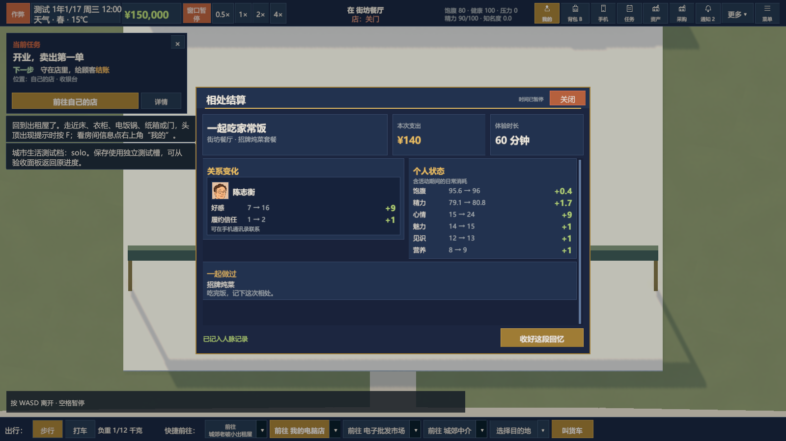

# 当前游戏完整内容归档（2026 年 11 月 13 日）

**最新状态见[2026-11-14完整交接](111-current-project-handoff-2026-11-14.md)。** 本篇之后已加入20种鱼及池塘操作、独立青湾旧物市场、扩充消费、61–100的户外／展会／经营事件和会员优惠券。51–58与76仍待补做；历史正文和增量段中的下一批编号以最新交接为准。

本篇汇总当前 Unity 工程的地图、经营、生活、社交、成长、展会、赛车和交付范围。本次更新覆盖门店到访明细、代养玩具、四片区医院、赛车入门及随机事件 01–30。[上一版归档](96-current-game-content-2026-11-12.md)

后续增量：随机事件 **31–40** 已接入实际单圈挑战、慈善赛、赴约观赛与夜骑、电池老化、赞助和护具。31 的夜宵为 ¥2,000，37 报名 ¥2,000、单独捐款 ¥500。详细规则及验证边界以[第 101 篇](101-racing-events-31-40.md)为准；[第 102 篇](102-event-money-audit.md)记录后续 41–126 的金额审查，下一批从 41 开始。下文其余归档描述保留原有范围。

再后续增量：**41–50** 已接入真实人物邀约、家宴、庆功宴和湿地训练，详见[第 103 篇](103-social-events-41-50.md)。KTV、酒吧、饭店等场所消费项目已翻倍，并加入高档套餐及包间，详见[第 104 篇](104-premium-venue-services.md)。当前下一批从 51 开始；历史归档和金额审查表中的旧状态保留作对照。

## 城市、时间与出行

- 主场景为 `Assets/Scenes/Main.unity`。Unity 2022.3.6f1、URP 和 uGUI 构成街道、家中、店内、展厅与赛车场的实体场景。主场景含全局后处理 Volume，URP 阴影距离设为 160。已有城市预览按时段和取景保留。[白天近景](previews/city_day_closeup.png) · [白天全景](previews/city_day_wide.png) · [黄昏近景](previews/city_dusk_closeup.png) · [黄昏全景](previews/city_dusk_wide.png) · [夜间近景](previews/city_night_closeup.png) · [夜间全景](previews/city_night_wide.png)
- 湖城 V15 保留城郊、社区、公园、花园四片区和十条街。平面线性尺度是 V14 的 1.3 倍，原有建筑本体大小保持。当前地图 JSON 有 130 个显式地点、1,073 个路网节点、1,090 条边。住宅还包括由建筑数据生成的地点。
- 每个片区各有一家 24 小时医院。地图可搜医院，生病事件可导航到最近可达的一家。门诊 ¥150、用时 1 小时、最多恢复 20 点健康。低健康触发的住院也在医院结算，两种治疗结束后都从医院门口出来。[身体不舒服事件](100-random-event-details.md#13--身体不舒服)
- 可租购商铺由 27 间增至 49 间，住宅由 97 处增至 132 处。新增住宅中 19 处登记住户，新增商铺中 12 间已有商户。空铺走挂牌流程，入住住宅使用现有 NPC 地址和产权规则。新房源接入中介地图、资产地图和导航。[地图与各片区数量](91-city-expansion-v15.md)
- 每月 30 天，每年 360 天。普通世界默认 1×，现实 1 秒约为 6 游戏分钟，可暂停或选 0.5×／1×／2×／4×。赛车有独立的实时驾驶时钟。
- WASD 移动，F 在场交互，B 打开背包。底栏有住处、门店、匹配主业的批发市场、中介及自选目的地。途中重新选目的地会以当前位置重新规划。步行速度乘 1.2，载具沿用各自速度。地铁未开放的目的站灰显，分区通行仍取决于主线资格。普通住宅和不可进入的背景商铺使用无底色标签，可互动的商业地点保留底色。
- 交通、访客和商家使用实体路网。湖岸、赛场接入和道路／人行道的铺装分层已修整，交叉口尽量共用边界，减少重叠闪烁。长程出行的距离随地图扩展改变。[道路铺装](74-continuous-roads-and-pavements.md)

### 暂停和操作

- 空格切换手动暂停。手动暂停时，重新按下 WASD 或方向键即可恢复时间并从这一帧走动。一直按住的方向键不会抵消刚按下的暂停。恢复沿用原来的倍速。
- 点底栏、地图、任务或预约里有效的「前往」，可直接恢复并出发。从室内发起时先走到门口，再接上街道路线。回家休息到床边、地铁和实际进出地点也会解除手动暂停。
- 弹窗持有的暂停在窗口关闭后释放。普通菜单、筛选、只选目的地和被规则拒绝的出发保留手动暂停。已经在路上时按空格可以停住，重新按方向键可恢复并接管路线。赛车继续使用自己的实时驾驶与暂停。

## 开店与门店经营

首餐教学完成后，第一次走出家门会高亮左上任务卡，玩家通过「前往中介」开始首趟导航。签下商铺后选择店型，默认选中宠物用品店，也可选其他普通店型。二手车行是分店业态，点击后弹出具体未满足的条件，具备资格后在中介签分店合同。

- 家具城在首家店定下店型后，首次进商店默认筛选该店型，后续进店默认「全部」。各店型先展示开店所需的设施，再展示适用规格和专用设备。住宅专用家具及无关设施可以从「全部」浏览。家具城和进货员使用同一套适用店型定义，去掉了独立的「开店清单」。
- 首店摆好设施后，任务引导前往本店型对应的批发市场购买第一批实货，再引导开业、成交和用人。已送的奖励货不会抵扣首次采购。旧档已有首单或实际完成采购的进度继续有效。预置经营档沿用已有库存。无对应市场的店型沿用自身进货规则。

| 店型或业务 | 当前可玩的流程 |
| --- | --- |
| 电脑店 | 盒装及散件零售、兼容装机、整机展示和交付委托。新品随时间推出，旧代受行情影响。 |
| 模型手办店 | 原创系列、常规和限定商品、热度变化、陈列与零售。 |
| 服装店 | 按品质和品类经营，季节、气温、试衣镜和销售员影响购买。 |
| 二手旧物店 | 卖家反复使用少量说辞，先谈价收购再鉴定好货、瑕疵、仿造或坏货，逐件定价后陈列。可在收购台附近按 F 办理，安排收购师后自动启用代理，由在岗收购师按预算出价和鉴定，可在订单页暂停。 |
| 餐馆 | 在灶台备料下锅，出锅后直接送到餐桌。顾客用餐后到收银台排队，由玩家或在岗收银员收款，服务员负责上菜和收桌。开业需要收银台 ¥600、灶台 ¥1,400、至少一张餐桌 ¥380 和冰箱，入门冰箱 ¥1,299。饮料有额外购买意愿，成交使用实际库存。 |
| 宠物用品店 | 基础、中档、高档用品批发和零售，猫狗代养、每天照料、玩具互动、饲养员和主人每周探望结算。 |
| 二手车行 | 社区开放后走人脉车源、检测整备、挂牌与低频成交，独立计算实际售车收入。 |
| 专用场馆和托管 | 网吧／电竞馆及部分场馆、物业改造和招商沿各自设施、员工与结算规则运行。 |

花店与生鲜保留城市消费地点或旧资产，新开自营店使用上面的现行类型。普通零售可混售实际陈列的商品，专用店型另有自己的操作流程。[店型核心](36-shop-core-gameplay-and-supplier-stock.md)

- 小／中／大店的室内大小和布局随房源规格变化，货架上限为 8／12／20 个，员工上限为 4／6／10 人。住宅室内也随房屋规格变化。
- 普通、加固、重型货架分别最多 20 件／60 千克、30 件／100 千克、40 件／160 千克，任一限制到达就停止陈列。库存页默认只显示各架品类与两个容量读数，满架标红，按架展开商品。后仓商品用同样紧凑的规格显示。背包与后仓之间的取放在共用储物界面办理。「全部放入后仓」保留背包里的饭盒、大米、食材及食物商品，只批量存放其他货物和家具。货架近景可看实际商品并调价，重型货架的标签和控件保有可读空间。
- 默认营业 08:00—22:00，可调整或手动开关门。离店提示根据值守情况说明能否继续营业。侧栏标题旁可直接改名，柜台最上方提供切换店型和退租／结束自营。重复的代养订单按钮已移除，订单仍可在宠物店的订单页或通过主人交互查看。柜台显示营业额、到店、流失、排队、预计进店、知名度、口碑和经营报表。底部状态说明开业设施、装修歇业或相应限制。首店装修歇业后需次日恢复营业。柜台数字、倒计时、货架数量和冰箱状态按实际业务刷新。「今日进店」可点开查看到访时间、顾客、正在选购／排队／成交或离店状态，成交列出商品和实付，订单列出待交付状态。「今日流失」按原因汇总，并可查看逐客明细。仅有计数的记录会单独标明。
- 自营店最高可标到参考价的 3 倍。基础购买意愿会随价格降到 0，销售员、镜子、包装、餐馆饮料和适用的品牌效果另参与计算。40 米内同类自营店按数量分流，包含自己共 N 家时各保留 `1/N` 基础客流。[定价](42-markup-up-to-three.md) · [陈列上限](44-shelf-item-capacity.md) · [商圈](45-local-shop-competition.md)

## 宠物用品与代养

- 暖爪宠物用品批发市场周一至周五 09:00—20:00 营业。目录有 17 种可陈列用品，分基础、中档、高档，包含猫狗粮、猫砂、玩具、零食及其他配件。店内照料也消耗实物库存。
- 从家具城采购小／中／大型宠物屋并布置在店内，按宠物屋和商铺大小共同限制容量。小、中、大各最多 4、8、12 只。顾客牵着猫狗到店时可靠近主人按 F 办理送养或探望。代养订单也可在店铺面板查看。
- 靠近宠物屋按 F 聚焦，保留顶部 HUD 与倍速入口。点宠物模型或名字可切换个体，查看状态、快乐、互动和照顾人员。未分配饲养员时明确显示无人照顾。在家具城购买代养区专用逗猫棒和软球，摆在宠物屋旁即可互动。低／中／高档的陪玩快乐上限为 75／90／100。逗猫棒三档为 ¥190／¥380／¥760，软球为 ¥160／¥320／¥640。批发市场同名玩具是零售商品，价格沿用原商品规则。
- 换水是全屋共用操作。猫砂、猫粮、狗粮按适用种类共用，每天各补一次，切换宠物时仍显示同一组照料状态。玩家可手动喂养、清理和陪玩。宠物屋显示已有照料覆盖和还需安排的饲养员数量。一名饲养员最多负责两只，到岗后处理共用照料和所属宠物的互动，魅力影响个体状态加成。
- 主人每周到店探望并按当时状态结账，最后一周结账后接回。基础周费为猫 ¥1,400、狗 ¥1,800，现有订单的下次结算也使用该费率。周实收为基础价乘 `0.45 + 0.85 × 状态 / 100`，按元取整。代养收入进门店账本。状态好可提升交情与门店口碑。

- 宠物屋上方直接提示待换水、待补猫砂或粮、缺货品种和待陪玩的只数。靠近后按 F 进入照料。摸摸、逗猫棒和玩球有场景动作，猫狗会走到互动位置并响应玩家，角色伸手和收回动作随互动阶段播放。猫狗平时在宠物屋范围内活动，暂停和离开时保持场景状态一致。

## 采购、配送与员工

- 电子批发市场集中展示电脑配件，按配件分类选货，每个型号只显示一条统一报价。原档口配额合并为该型号的市场每日库存，玩家与进货员共用。市场人员合并为市场接待、配货、库存和供货等岗位，其他人员在各自新地点活动。电子、模型、服装及宠物用品批发统一在周一至周五 09:00—20:00 营业，周末休息，地图、店面、打烊提示和采购执行共用该时段。农贸等其他货源沿用自己的营业规则。
- 同一供应商、同一型号、同一天的额度由所有分店和进货员共享。安排时按星期检查已经分配的额度，当天实际进货还检查剩余实货。可选每天一次、周一三五、每周三。固定清单按顺序和数量，最大采购按可用配额，阈值模式按库存缺口。保存次日起生效，实际执行仍检查起订量、预算、车况与运力。
- 定期采购清单显示已生效的频率和下次日期，选项是草稿，点「完成」才保存。每周三的计划只在周三启动，同一天的续运属于同一计划。小电驴、三轮车、自有小货车每趟分别可装 20、80、160 千克。超重时先买能装的部分，返店卸货再跑下一趟，每趟检查剩余库存、现金、车辆、营业时间和班次。暂停采购会停止续运，已付款的货照常送达。中途到货用简短通知，最后一次到货或无法继续时显示可滚动的结果。待采购件数与已付款在途分开记录，保存后可以继续。采购记录标明每趟的出发、送达、货源和费用。
- 采购目录和已选清单按滚动位置加载可见附近的商品行。目录在打开窗口时生成一次，行内固定上限、最大数量和周配额共用一份计算。预算预览复用目录，保存时仍检查配额。
- 实体购物优先背包，超重可叫车。家具城和其他实体货运购物记住上一次有效收货点，家具城首次有店时默认第一家自营门店。手机网购也能选家或门店。应用内包含家具、摆设、衣服、礼品、大米和电脑配件，交付实际进入相应储物。电脑配件通常次日 10 点送达，生活网购按两天配送规则。店铺采购页集中显示库存、补货目标、在途和直供协议，网购从手机打开。[采购配额](38-supplier-model-allocation-and-weekdays.md) · [网购](57-simplified-online-shopping.md)
- 顶栏「员工」按门店分组，也有待安排分组。员工卡默认显示头像、岗位、职责和日薪，展开可看实际效率、调动、工资和管理按钮。应聘名单显示工作相关属性，选岗位可比较实际效率；「待安排」在岗位列表最后。进货员卡常驻采购按钮，未设置或已暂停时标出状态。打开清单默认选择对应批发市场，如服装店选四季服装批发行，电脑店选电子批发市场，也可自行切换。支持同岗多人、日结、跨午夜班次、加班和跨店调动，实际到岗后才提供效果。

## 主角属性、压力与工作

- 工作能力为智力、魅力、动手能力和体能。「我的」状态页列出四项，顶部状态栏和「我的」显示 0–100 压力，达到 70 时提示。体能影响体力岗位的精力消耗，准时完成体力班可提高体能，靠这类工作最高练到 85。
- 正在工作的时间累积压力，夜班的基础压力高于白班，岗位主属性越高，工作压力越少。清醒时的疲劳也会增加压力。睡眠每游戏小时减 2 点压力，完成带正向心情效果的休闲项目也会减压。
- 进入 NPC 店铺点「在这里打工」。签约页显示主要属性、当前属性值、预计表现奖金、整班压力、精力消耗及收工健康和心情变化。导购与接待看魅力，维修和制作看动手能力，搬运和理货看体能，企业、社区服务及宠物批发看智力。
- 合同次日生效，工作一周，工资每班自动到账。到岗时主属性超过 50 可获表现奖金，最高为底薪的 25%。到岗精力低于 25 时奖金减半，压力达到 70 时再乘 0.75。迟到扣底薪并按比例扣奖金，缺勤无当班工资。合同记录累计到账、奖金及扣款。
- 招聘及换岗选中岗位后，直接展示个人属性、用时与加减成。动手能力影响收银、装机和厨师的操作用时，装机经验还可缩短用时。智力影响每种货的采购用时和二手收购鉴定准确率。体能影响服务员的操作用时。魅力影响销售购买意愿和宠物照料状态加成。场馆值守按出勤提供营业支持。压力、属性、在岗表现和工资记录随存档保存。[员工](13-employees-and-procurement.md) · [打工](18-player-work-and-weekly-pay.md)

## 中介、物业与客流

- 四家中介分别负责本片区。房源要求按人物名望标注，中型和大型商铺对应名望 25 和 60。商铺、住宅共用片区地图和房源详情布局。房源概况、预计每日入店人数与办理结算紧邻排列，预计人数突出显示。可定位中介、查看商圈或放大房源。租赁确认使用短标题，把完整房源名、关键金额、合同周期和押金规则放在正文。
- 商铺按周交租，基准最低约 ¥2,000／周。新租报价取地段和面积带来的基础进店客流，客流越高租金越高，涨幅低于客流涨幅，再按周行情调整。签约付首周租金、一周押金和半周中介费。中介费显示与经办人熟悉程度和减免幅度，已签租约保留签约价。主动退租走库存、员工和未完成业务检查。
- 地图按整段路面着色显示街道人流。浅青表示较少，深青表示较多。点商铺看预计每日入店人数。预计值与实际来客共用地段和营业时间口径，地点、面积、周末、同类竞争和经营成长造成差异。新店估计按正常营业计算，实际来客也受值守、开门时段、口碑／品牌效果及餐馆周转影响。街道热度可随经营增长。
- 住宅可同时租住多套。初始出租屋 ¥500／周，其他住宅签约时支付首周租金，之后按各自签约价每七天扣款。签新约会保留原住处，退租默认住处时自动改用另一处可入住住宅，至少保留一处。空房可租住或全款购入自用。带租户购买后住户继续居住，购入七天后开始按套收周租。住宅和商铺均全款交易，住宅售价、住宅周租、商铺售价、商铺周租纳入每周物价行情。[住宅系统历史规则](63-residential-map-and-tenanted-ownership.md) · [全款产权](82-cash-only-properties.md)
- 「资产」的门店页按街区、店型和单店折叠与切换，列最近七天收入、支出、差额、来源和折线。物业页用同一张连续地图从全城缩放到四片区，每栋可点建筑显示基本信息，购买、租用和其他房源不同色。右侧按拥有和租用分组，双击定位。车产页再显示四区和车型分类。[资产地图](84-assets-stores-and-property-map.md)

## 财务、手机、住宅生活与证券

- 「行情 → 经济简报」在同一窗口提供收支结算和物价涨跌。默认每周弹出，左下频率菜单可选每两周、每月或关闭。可翻期，查看总收入、总支出、来源、净收支和期初／期末现金。现金流水按天、周或月查看，收入与支出在图中对照，下方按笔列明细。内部调拨单列，单店资产页的七天经营折线使用独立口径。
- 城郊银行 09:00—17:00 开放。地图标牌有商业地点底色，使用已有具名 NPC 张淑琴作为实际到岗柜员，可像其他商店人员一样查看和聊天。柜台分「存取款」「借款」「我的贷款」三页，显示随身现金、活期余额、期限、总利息、到期本息和实际扣款日。存取按整数元输入，借款按 ¥100 为一档、最高 ¥1,000 万，期限 1–12 个月。活期月息 0.3%，按日滚入余额。银行和手机共用贷款账本，普通贷款月息 20% 单利。到期优先用现金、再划转活期存款，余额仍不足时可扣成负数。提前结清与借款申请均核对本息。朋友无息借款也在记录中。HUD 显示最近一批应还本息与现金缺口。
- 顶栏、手机与居家工作台共用日程入口。持智能手机显示月历，按日格查看当天安排，支持翻月、回今天、按通知定位日期，并从条目查看详情或前往。未购智能手机时使用最近 5 天的笔记本。天气保留独立入口，原「城市活动」页签已移除。右侧常驻未来七天安排。月历覆盖邀约、展会、直播、交付、打工、维修、快递和还款。过早尝试赴约时会提示约定时刻与最早出发时间，最早时间按路线耗时与到场窗口计算。
- 正常新档启动资金为 ¥15,000，初始饱腹 25，家中后仓有 20 千克米。开场先教移动，再引出第一项任务「做第一顿饭」。电饭锅从背包和家中后仓取米及配菜，焖饭完成后点「现在吃一碗」即时结算饱腹和健康等效果。教学要求先吃一碗，再把剩饭打包。饭盒可在饭点或饥饿时自动食用。开场教学冻结世界时间时，HUD 和窗口显示暂停状态。首次买到智能手机时可从提示直接进入自动订餐设置。开启后先吃手头食物，没有可吃的食物才按所选价位下单，也可从「我的 → 饮食」调整。低饱腹会给出吃饭提示，饱腹耗尽会损失健康，住院按一天结算。
- 大米、肉、菜、蛋、豆腐等原始食材可长期保存。焖饭、外带餐品等成品有保质期，放入冰箱暂停计时，取出后继续计算剩余期限。家中和店铺纸箱可打开各自的共享后仓。城市场馆的不同服务有各自的报价及饱腹、精力、心情、健康或关系效果，选项目时可比较。居家经营工作台提供家庭账目与经营入口。[永久冷藏](35-permanent-fridge-storage.md) · [工作台](37-home-workbench.md)
- 手机安装「证券」后打开横屏大窗口。底部可切换走势图、交易所和新闻，交易所整屏表格分现货与做空。成本价紧跟「我的持仓」，点公司名在该行下方展开近七天走势、总成本和浮动盈亏，图中用虚线标出平均成本。股票每手 100 股，指数按份。数量变更时，现货买入按钮会更新含手续费总价；点股票所在行可成交。窗口内显示失败原因。触及预留资金时先确认实付、余额和预留金额。
- 证券周一至周五全天可交易。工作日 10:00、13:00、16:00 更新报价，周末休市。当前有 10 家股票公司和硬件景气指数。公司经营数据、新闻、行情、季度分红、持仓成本和已实现盈亏实际记录。做空冻结保证金与卖出所得，按日收借股费，符合强平条件会自动平仓。账户顶部显示总浮动盈亏和已实现盈亏。[证券完整规则](90-stock-market-and-short-selling.md)

### 睡觉和回家

- 「睡觉」直接显示当前时刻、精力、过去 24 小时的睡眠以及欠觉。常驻「睡 8 小时」「小睡 2 小时」和自选起床时间，显示今天或明天何时醒来及预计睡眠时长。天气、床、室温与疲劳规则收在「睡眠说明」。
- 自家入口直接进门。底栏住宅快捷键可选择可入住住宅并自动走到床边打开睡觉窗口。住宅选择和实际出发是两个操作。

## 人物、区域成长与验收入口

- 具名 NPC 有身份、作息、住处、关系、个人经历和复古漫画头像。住宅登记人决定实际居住。交情、送礼、交换名片、邀约、消息和真实会面共用人物流程。扩建片区的经营者与住户接入真实地址和作息。匿名顾客与路人用于城市和店面人流。
- 人物名望与各店知名度、口碑分别显示。玩家名望由经营累积、各店共用，参与租铺、开分店、直供、企业业务和片区成长门槛。NPC 名望按身份、职务、年龄等稳定计算。资料和「我的」可查看，档位为默默无闻、街坊熟知、小有名气、圈内知名，分界点为 8、25、60。
- NPC 借款按事件约定处理，日程列出还款日。收回时实际入账，通知列出实收和到账后现金，现金流水记为「借款已收回」。表哥还款存在逾期，届时可催款、延期一次或认亏。
- 城郊升社区从五家营业店、现金 100 万元和等待引荐开始。沿李秀兰、陈启明、唐蔚的任务和三位保管人线索到场活动，找齐三页后交给唐蔚，开放社区。
- 社区升公园从社区六家开业门店、净资产 3,000 万元和品牌开始。会展中心外见任帆。检查该品牌符合要求的历史展会、实际采购交付和知名度，达标时使用已完成记录中最佳的一届，未达标时继续下一届。完成推荐人当面确认后开放公园。
- 公园升花园检查品牌行业上个完整月营业额 1 亿元，继续企业竞标、调查、10 件试单和同合同三期各 30 件交付。原旧版活动等主线已移出流程。已确认未来将「自有公司正式上市且股价至少 ¥100」加到公园升花园，当前上市系统尚未接入任何区域的通关门槛。[现行主线和设计边界](story-and-district-progression.md) · [展会和竞标任务](58-mainline-exhibition-and-tender.md)
- 编辑器验收可直接准备相应阶段并同步解锁前面的片区。品牌和展会验收有实际门店、商品、资金与社区住处，赛车和资产有独立车辆、车位与经营预置。验收档设置与正式新游戏分离。

### 对话、关系与恋爱

- 人物对话左侧是头像、姓名、职业及熟悉度，右侧是大面积当前台词。点击选项原地更新当前回复，底部使用等宽选项，「结束对话」同排。头像可进人物资料。初见时首次「聊聊」即为招呼。熟悉度至少 10 可以当面交换联系方式，成功后该入口消失。业务名片按业务约定办理。
- 熟悉度高于 70、在同一地点且双方符合条件时可表白。71、80、90、100 熟悉度的接受概率分别为 30%、50%、75%、95%，中间按区间线性增加。被拒后仍可正常交谈和邀约，7 个游戏日后可再次表白。玩家同时只有一位伴侣。分手后可恢复普通交往。已明确的非候选状态包括江雨恋爱中、吴怡已婚和周国良丧偶。
- 双人实际到场的活动可使用伴侣专属台词、「牵手」及「聊聊心事」，并写入活动结算。伴侣关系和拒绝冷却随存档保存。陆栀通过会展复盘及后续个人事件提升熟悉度，表白由玩家自主选择。旧档中已经确认的陆栀关系按兼容规则恢复。
- 具名 NPC 当前有 124 张专属头像，另有一张通用头像。本轮更新了其中 100 张资源，含通用头像。场景服装按人物搭配 12 类造型，包含成熟剪裁、甜系、暗黑、朋克、手作、Cosplay、户外、学院、赛车、工装、经典和街头，按气温选短袖或厚外套等版型。余佳与郑可的资料和话题包含 Cosplay 兴趣。美术停在当前入库资源版本，后续单独处理。

| 片区 | 可发展恋爱关系的角色 |
| --- | --- |
| 城郊（8） | 许明、苏骏、雷鸣、陈启明、唐晓芸、邓悦、郑禾、许星澜 |
| 社区（7） | 莫文宁、柯承安、乔雨桐、白明、任帆、顾宁、曾玉 |
| 公园（8） | 陆栀、温岚、宁汐、陶然、赵予、陈志衡、陆景行、林远航 |
| 花园（7） | 江宁、陶川、季云、夏清、顾若宁、司雨、罗雅 |

### 随机事件与编辑工具

- 随机事件从 `Assets/Resources/Data/events.json` 读取，共 123 个条目。从开局计日第 2 天起，在有门店且没有待处理事件时，于 11:00、15:00、20:00 各抽一次。每时段基础概率 40%，前 14 天减半。每天最多 3 个，连续 7 天最多 10 个。候选检查日期、条件、冷却和独立触发概率，再按权重抽取。
- **01–10**接入实际门店检查、库存差错和顾客到访。学生团购按六种店型扣真实库存或食材，九五折额外加门店人气。价格战按选择改变该店人气、员工日薪或受影响商品售价。拾物、约饭和借款各走实际的地点、日程与账务。
- **11–20**接入 ¥1,000 来源核验、¥200 传单推广及就医。做客邀请与真实住址存入人物资料。转介绍按六种店型报价和交付，个人熟客单可报七折，培训机构单保留保证金、交期和奖金。涨租只调整实际谈到的那份商铺周租。
- **21–30**接入次日清仓配送、具体型号调货和到期判定的借款。深聊和车友聚会走实际邀约。正赛写入日历，整备 ¥800 并恢复实际车况，收藏车试驾使用赛道驾驶，许明的 ¥3,000 借款在比赛约成后支付。
- 31–40 的增量已接入实际挑战、慈善赛、赴约、电池、赞助和护具，见[本批规则](101-racing-events-31-40.md)。周末搬货实际经过 8 游戏小时，完成结算 ¥300；金额偏小的问题已记入后续审查。熟人休闲邀请和林远航救急独立触发，也有验收编号。41–124 中其余可触发条目保留现有玩法，102 的亲戚借款已合并到 09。[完整事件编号](98-random-event-index.md) · [全部事件明细](100-random-event-details.md) · [逐批改造与换机交接](99-random-event-handoff.md)
- Unity 编辑器内点「作弊 → 随机事件批量验收」，可选 01–10、02–20、11–20、21–30 等区间，最后一批为 121–126。每批从独立测试场景开始，处理选项并关闭结果后会依序弹出下一项。可停止批次或返回进入前的进度。
- Unity 的「PCShop → 事件」可看清单、校验、在运行时触发和导出人物名单。独立 WinForms 工具位于 `ExternalTools/EventEditor`，支持编辑事件、条件、效果、人物及抽取参数。[事件格式与编辑器操作](events-json.md)

### 活动与相处结算

- 结算顶部显示活动名称、场所、服务、本次支出和实际用时。缺少实付记录的历史活动将费用标为参考值。
- 同行活动左侧按人物展示头像、好感和履约信任，右侧展示个人状态。个人状态只列有变化的数值，并计入活动期间的日常消耗。增加用绿色，减少用橙红色。单人活动省去关系栏。
- 超过到场窗口仍未到约定地点时会弹出「未赴约」。同伴交情下降 8 点，履约信任若大于 0 则下降 1 点，无活动扣款，可从活动记录回看。由 NPC 做东的实际活动由邀请人付款。互动内容和活动结果放在下方，正文可滚动，关闭操作固定在底部。历史结算可从活动详情重新查看，主线的活动后线索仍在关闭结算时打开。

下图由 Unity 渲染，使用街坊餐厅饭局的示例结算数据。

## 品牌、MCN、直播与展会

- 右上「品牌」可进入总览、展会、企业竞标和代言人。电脑、服装、模型达到行业门店和经营资格后可建品牌。总览显示门店、近七天来客与账目、品牌知名度、口碑和代言人的实际直播贡献。初级／中级／高级分别可签 3／7／12 人。
- 澄光传媒、衣见文化、玩界工作室共用社区 MCN 接待。先比较公司与主播，再到场办理介绍并获取业务名片，之后可当面或用手机谈独家代言。主播的头像、魅力、智力、粉丝、人气和费用各自记录。代言与 KOL 是同一份合约，直播和参展复用当前品牌的签约关系。
- 签约一次支付代言费，品牌场按实际开播付场费。主播可排各自的起止时间及每天、隔天、每周一次的品牌内容频率，时段可跨午夜。手机直播大厅显示场次、主播、品牌，观看可送礼。原有直播场景按实际主播、商品和直播阶段替换图层，使用 15 位主播透明素材和实际展示库存。结算反映直播对人气、粉丝、品牌知名度、口碑的实际影响。[品牌合约与直播细节](88-current-game-content-2026-11-07.md#品牌经营与独家代言) · [场景图层](75-existing-scenes-and-replaceable-showcase-art.md)
- 季度展会每 90 天一次，连续 4 天。小／中／大摊位要求每种展品 100 件，品种数分别 1–2／4–5／6–8，至少 1／5／8 位合同覆盖展期的本品牌代言人。中、大摊位需要海报。报名使用所选门店的真实库存，另计摊位、海报和站台费用。代言人的邀请卡分开显示每日站台费和四天合计。
- 会展中心非展期显示下次日期和报名入口。报名后会给出报到时间、日历和出发提醒。展期到场报到后进入 3D 展厅，点摊位、舞台或接待查看现场。每天六段互动，可手动或开启自动选择。同届多品牌可联合报到并在同一场次切换，全部完成该段才推进，共用四天日程，各自结算。
- 展后居中结算展示逐商品收入、售出和退回、摊位／海报／实际站台费、现场收支、口碑与知名度增量。余货退回，采购订单按实际评分获得并需要交付。结算和奖励按品牌保存。企业竞标包含真实试单、评审、中标和后续履约。[展会现场](66-expo-scene-and-onsite-interaction.md) · [联合参展](81-joint-multi-brand-exhibition.md) · [企业合作](54-brand-expo-tender-playable.md)

## 车辆、公共车库、赛车与二手车行

- 顺丰车行与湖岸汽车城各有车辆目录，按小电驴、三轮车、货车、轿车分类。车行、车库及车产展示车型图；基础信息默认精简，可展开极速、加速、抓地、转向、制动、稳定六维图。车型图和 Unity 元数据一起保存。[车辆美术提示词](art/vehicle-portraits-prompts.json)
- 四个片区的公共车库设在对应赛车场旁。车库建筑是公共设施，可按需租或全款买不限量车位。四区统一为 ¥500／位／30 天，买位 ¥10,000／位。小电驴、三轮车和轿车各可设一辆通勤车，通勤车不占车位。要把通勤车用于赛场，先在车库点「停入车库」并确认取消该车的通勤用途。练习和参赛在接待处选择本区已入库车辆。车库或赛场接待可付费从别区调车，占目标空位。货车属于全城员工进货车队，实际占用具体车辆，不参加通勤或比赛，也不需要车位。[车位与调运](85-regional-garages-and-parking-spaces.md)
- 现金超过 ¥100,000 且结清全部欠款后，由许星澜发出一次邀请，开放赛场。入口在「更多 → 赛车」，引导购买小电驴或三轮车、办城郊车位、入库并完成城郊首跑。首跑完成后，车友相关随机事件才进入抽取。城郊练习场全天开放，其他赛场练习时段及正式比赛为 09:00—18:00。练习 ¥100。每周一大赛报名 ¥2,000，冠军 ¥20,000。每三天一次小赛报名 ¥1,000，冠军 ¥10,000。撞期优先大赛。比赛最多 10 名同场车友。正式比赛检查区域、胜场、当地车库车辆及车况等条件。健康和精力没有准入门槛，事故仍可能带来车损和受伤。
- 驾驶固定 1×。W 沿车头加速、S 刹车／倒车、A/D 转向，空格或 Esc 暂停／继续，Shift 手刹、R 复位、Tab 全景。默认较远的后上方跟随，右键调整、滚轮缩放、V 回正。赛场车辆使用所选车型和涂装。赛道围栏衔接按边界生成，减少同面闪烁。
- 在人物原有「邀请活动」里选「一起参赛」，指定比赛日期与赛场，接受邀请的车友当天实际前往并优先入列。完赛结算显示名次、奖金、时间、车况及交情变化。练习也有结算。二手车行可从熟人收车或调入自有车，检测整备后挂牌，实际买家到店时决定是否成交。[赛事与车友](87-race-meetings-and-logistics-trucks.md) · [二手车与赛场](69-lake-racing-and-used-car-shops.md)

## 存档、技术与交付范围

存读档覆盖分店、租约及房屋产权、家具和存货、员工与配额、在途、主角压力和体能、打工合同、人物活动、品牌直播和展会、车辆、宠物代养、证券、银行本金及利息尾数、无息借款、随机事件频次和冷却、门店当日到访明细、应急灯和停电状态、周末兼职、事件借还款、赛车解锁与经济简报偏好。事件新增的复查、预留货、传单推广、转介绍、真实活动、采购配送和试驾邀请沿对应系统持久化。已有资源包括主场景、城市数据、图层素材、人物头像、车辆图及对应 `.meta`。界面使用灰蓝底与金色强调色，长列表使用可拖动滚动条，人物头像保持原比例。[事件存档和验证](99-random-event-handoff.md) · [美术登记](asset-log.md) · [实现盘点](89-implementation-debt-audit-and-first-fixes.md)

本次归档包含 Unity 源码、资源及元数据、外部事件编辑工具、工程文档和已有预览。验证与 Windows 交付记录见下方。自有公司 IPO、后续人物支线和正式发行仍在开发范围内。

### 构建与验收

- 本次源码通过 Unity 的 Core、Game、Editor 和 EditMode 测试程序集编译。随机事件定向与扩展回归的结果、已知边界和手动验收范围见[事件交接](99-random-event-handoff.md#本次验收边界)。Windows 与 WebGL 构建记录沿用历史交付。

- Windows 采用 Unity 2022.3.6f1 构建 `StandaloneWindows64`，入口为 `Assets/Scenes/Main.unity`。此前交付的 `F:/PCShopSell_builds/PCShopSell-Windows-20261112-193021.zip` 为暂停修复前的 Windows 快照，约 66 MB。包内 133 个文件通过 CRC 和逐文件哈希检查。Windows 客户端通过 Direct3D 11 启动检查，核对了 6 个存档文件及备份的哈希。
- WebGL 第一章试玩入口 `WebGlTrialBuild.Run` 使用城郊范围与独立存档目录。交还商铺图后可继续留在城郊经营。完整版在对应剧情节点继续开放社区等片区。
- 对话和恋爱已做 Unity 图形验证，覆盖首次招呼、等宽按钮、一次性交换联系方式、表白与在场伴侣互动。此前的头像、恋爱和服装 EditMode 联合检查通过 22 项。场景服装冒烟覆盖 124 位具名 NPC。
- 11 月 12 日的暂停修复跑了 106 项 EditMode 检查，通过 94 项。新增检查覆盖重新按方向键、保持弹窗暂停、从室内出发与路线开始，全部通过。其余 12 项失败均在暂停修复前的同一工作区复现。另将睡眠导航测试的窗口识别更新为现有界面的稳定控件名，六项相关检查恢复通过。

相关历史设计：[界面精简与买东西 / 采购 / 进货员界面改版](94-ui-simplification-and-purchase-screens-2026-11-09.md)
