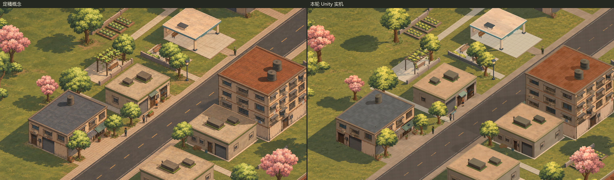
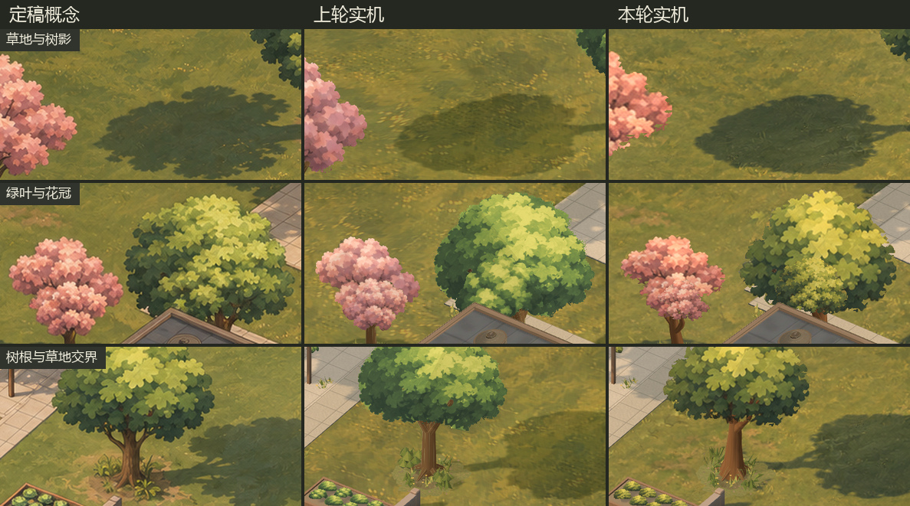

# 城郊旧居街 · 美术实装与交接

2026 年 11 月 26 日，第 12 轮城郊近景与鸟瞰已确认定稿，作为后续街区的画风基准。复拍的正式地图为 v16。[定稿图与沿用流程](../四区场景复核/三区实机验收/同机位复拍-2026-11-26/城郊画风定稿.md)

2026 年 11 月 25 日，Unity 2022.3.6f1，`art/experiment` 分支。开局街角、对街住宅和楼后的公共院巷已接入游戏。28 栋住宅复用两种外壳，主角住进面积 27.6㎡ 的小平房。街道布局、室内租住和画面都能从同一组实机记录查到。



| 想看什么 | 入口 |
| --- | --- |
| 三张定稿概念 | [开局街角](交付图档/城郊两种住宅_开局街角.png) · [从院子回望](交付图档/城郊两种住宅_从院子回望.png) · [片区鸟瞰](交付图档/城郊两种住宅_片区鸟瞰.png) |
| 最终实机和定稿 | [街角原图](实机采集/rental-close.png) · [院子反向对照](交付图档/城郊植被与光线_院子反向同机位.jpg) · [片区鸟瞰对照](交付图档/城郊植被与光线_片区鸟瞰同机位.jpg) · [带 HUD 的实机](实机采集/gameplay.png) |
| 材质、昼夜和玩法 | [草地、树冠和树根三方对照](交付图档/城郊植被与光线_局部三方对照.jpg) · [同地点昼夜](交付图档/城郊植被与光线_同地点分时实机.jpg) · [中介两种房源](交付图档/城郊落地_中介房源.jpg) |
| 早期试稿、动图、提示词与原图包 | [交付文件索引](图档索引.md) · [文件清单与 SHA-256](文件清单.tsv) |

## 从原始街景到城郊定稿

起点是斜俯视下的一段中国老街。参考里的旧楼墙面略暖、背光面偏灰，深色沥青和窄人行道把视线引向店门。树冠由深浅叶簇构成，树影里依然看得见草地的笔触。城郊本次采用了较干净的版本，把磨损集中在窗台、门槛、雨棚边和常走的地面，开局旧居可以比邻栋更旧。[最初街景参考](../reference/ref3_scene.jpg) · [项目整体风格指南](../STYLE_GUIDE.md)

| 阶段 | 采用的决定 | 留档 |
| --- | --- | --- |
| 单栋样板 | 从游戏原有机位出发，先对齐楼形、层高、门窗和太阳方向，再调墙面、屋面与树脚。白天减少全屏调色，让亮面保有材质本色。 | [早期同机位](交付图档/目标原图与当前Unity实景.png) · [渲染诊断](交付图档/旧居街渲染诊断.jpg) · [笔触四版](交付图档/旧居街笔触四版对照.jpg) |
| 连续街段 | 沿道路采集多个真实角度，先画站口、商铺和住宅局部，再从整段街景统一检查明度、密度和老旧程度。路面取消了重复的蓝灰色斑点。 | [整段与局部](交付图档/城郊旧居街_整段概念与实机.jpg) · [连续步行](交付图档/城郊旧居街_连续步行.webp) · [路面取舍](交付图档/城郊路面斑点_删除前后.jpg) |
| 两类住宅与院巷 | 以同一块真实地皮画街角、反向和鸟瞰三张定稿。小平房、多层楼、普通商铺各自复用外壳，差异集中在屋缘、窗格、雨棚和住户门前。 | [片区定稿](交付图档/城郊两种住宅_片区鸟瞰.png) · [中介与室内记录](实机采集/visit.txt) |
| 草地、树冠与光照 | 对齐晴天时刻和镜头，分别看向阳草地、树影、花冠和树根。在反向镜头检查纹理是否贴地，再看黄昏与夜间。 | [最终局部三方对照](交付图档/城郊植被与光线_局部三方对照.jpg) · [实机光照配置](实机采集/lighting.txt) |

## 住宅、中介、店面和步行

| 房型 | 片区数量 | 街上特征 | 对应房内空间 |
| --- | ---: | --- | --- |
| 小平房 `lane` | 16 | 低矮平顶、浅色屋面、通风帽。主角家 `home` 和对街 7 号均属此型。主角家临街和院侧都有布雨棚。 | 6 × 4.6 米，27.6㎡ |
| 多层楼房 `walkup` | 12 | 暖灰墙、红褐屋顶、成组窗格，6 号住宅是代表。窗面细节按地点 ID 选择。 | 城郊零级房源的一套室内为 7.2 × 5 米，36㎡ |

房源类型写入地图数据。地图外壳、碰撞尺寸、中介卡片、室内户型和搬家时的家具安排共用同一类型。原有地点 ID、地块与门口位置继续使用。小平房外部占地上限是 9.5 × 9.66 米，这个数与可布置家具的室内面积分别计算。更高等级住宅继续使用相应等级的室内规格。[地图数据](../../../Assets/Resources/Data/city_layout.json) · [户型与外部尺寸](../../../Assets/Scripts/Core/World/CityLayout.cs) · [房内尺寸](../../../Assets/Scripts/Core/Home/Furniture.cs) · [中介显示](../../../Assets/Scripts/Game/UI/GameUi.ResidentialAgency.cs)

城郊普通零级临街商铺复用灰顶 `Shopfront`，用门头、招牌、雨棚与陈设区分商家。专用场所保留各自的营业、进门与室内逻辑；城郊站使用独立站棚。住宅门牌、招租和营业状态仍能在游戏中辨认。进出开局旧居时有对应街景取景，街区内行人的身体比例、脚下接触影和受光也随区域调整。[建筑分配](../../../Assets/Scripts/Game/Runtime/StreetWorldBuilder.StarterArt.cs) · [建筑与门口](../../../Assets/Scripts/Game/Runtime/StreetWorldBuilder.OldQuarter.cs) · [场所外观](../../../Assets/Scripts/Game/Runtime/StreetWorldBuilder.Planned.cs)

公共空间围绕日常活动分组。葡萄架和长椅贴着院墙，菜畦、晾衣区和自行车靠近入院小路，路口与住宅门前保留通行宽度。16 段小路共用一套中心线，铺装和可通行范围由同一份坐标生成。布局核对覆盖城郊 77 个地点的入口坐标、朝向、地块宽深，其中 28 个为住宅。[院巷布置](../../../Assets/Scripts/Game/Runtime/StreetWorldBuilder.Courtyards.cs) · [小路中心线](../../../Assets/Scripts/Core/World/OldQuarterLanes.cs) · [基线地块](布局基线/lots.tsv) · [最终地块](实机采集/lots.tsv)

## 材质、植被与光线

| 近看部位 | 当前做法 | 主要资源 |
| --- | --- | --- |
| 外墙、窗洞与雨棚 | 整面立面绘制底色，窗洞、窗帽、格栅和雨棚用实际几何制造遮挡。压低灰泥光泽，只让玻璃、铁件和水箱局部接光。 | [建筑资源与材质](../../../Assets/Resources/OldQuarter) · [立面与屋顶原画](../concept/old-quarter) |
| 道路和门口 | 沥青、路沿、车道虚线和人行道独立着色。通往门口的磨损按实际位置取样，保留大片安静的路面。 | [道路实现](../../../Assets/Scripts/Game/Runtime/StreetWorldBuilder.RoadSurfaces.cs) · [门口磨损图](../../../Assets/Resources/OldQuarter/FrontageWear.png) |
| 草地 | `ResidentialMeadow` 给出片区的大范围色差，`RouteGrass` 提供可平铺、带方向的草梢，`MeadowStrokes` 保存街角和院子可见草地的局部笔触。用真实地面可见性和日照筛选原画取样，提取相对周围底色的变化，再映射回地面。路边和树脚另有带高度的草叶与小花。 | [着色器](../../../Assets/Resources/OldQuarter/QuarterPaint.shader) · [局部取样](材质取样) · [立体草叶](../../../Assets/Scripts/Game/Runtime/StreetWorldBuilder.Verges.cs) |
| 绿树和花树 | 从定稿提取两种绿冠和两种花冠，保留叶团外缘、透空和冷暖变化。主冠与偏移的小冠叠在真正的树干上。树皮纹理顺着渐细的树干和分叉延伸，树根旁的草叶带弯折。 | [四种叶冠原稿](../concept/old-quarter/residential-crowns.png) · [树冠着色器](../../../Assets/Resources/OldQuarter/QuarterCanopy.shader) · [树干与根部模型](../../../Assets/Resources/OldQuarter/CourtyardTree.obj) |
| 城郊日照 | 晴天街区中心的太阳角度为俯角 38°、方位相对开局住宅朝向偏转 −48°。草地受光面偏暖，树荫保留冷色。离开片区以及进入黄昏后，按距离和时刻平滑过渡。 | [昼夜控制](../../../Assets/Scripts/Game/Runtime/DayNightLighting.cs) · [区域权重](../../../Assets/Scripts/Game/Runtime/GameController.cs) |

最终采集使用 Unity URP 14.0.8、Direct3D 11 和线性色彩空间。09:14 的实机主光使用 4096 阴影贴图、四级级联、软阴影，强度 0.74。该机位的相机后处理处于关闭状态。投影来自实时光栅化阴影，硬件光追处于关闭状态。18:10 和 21:30 在相同位置重新采集了游戏画面。[管线设置](../../../Assets/Settings/PCShopSell_URP.asset) · [上午](实机采集/rental-close.png) · [黄昏](实机采集/dusk.png) · [夜间](实机采集/night.png)



## 复拍与验证

下表为正交机位。焦点采用 Unity 世界坐标，正交尺寸为相机可视高度的一半。复拍时先固定时间、天气、镜头和地块，再分别对照建筑轮廓、草地笔触、树影和门口。表中角度与位置为方便阅读做了四舍五入。[完整精度与全部机位](实机采集/cameras.tsv) · [各机位下门口的屏幕坐标](实机采集/projections.tsv)

| 机位 | 焦点 X / Y / Z | 水平角 / 俯角 | 正交尺寸 | 原始分辨率 |
| --- | --- | --- | ---: | --- |
| 开局街角 | −438.24 / 2.50 / −527.19 | 210.73° / 34° | 16 | 2400 × 1350 |
| 从院子回望 | −445.28 / 1.60 / −539.54 | 34° / 36° | 17 | 2400 × 1350 |
| 片区鸟瞰 | −493.79 / 6.00 / −517.48 | 193° / 45° | 69.94 | 2880 × 1620 |

最终采集的会话从预生成地图启动。主角点击门口后进入 6 × 4.6 米小平房，中介分别显示 27.6㎡ 与 36㎡。实机通过中介租下 21 号多层住宅后进入 7.2 × 5 米室内，再搬回开局住房并进入 6 × 4.6 米室内。对街 6 号、7 号在采集存档中已有住户，门口可点击，直接入户被居住权限拦下。[交互原始记录](实机采集/visit.txt) · [两种房源的实机界面](交付图档/城郊落地_中介房源.jpg)

画质仍有两处可辨差距。街角大树的亮叶在实机里连成片，定稿在叶团中间留有更多暗缝和枝杈。反向看院子，实机树根到泥地的过渡也比定稿平滑。后续可沿用同机位，优先核对这两处。当前记录覆盖编辑器实机和上述交互，平台帧率、显存及发布包体积仍待单独测量。

## 从仓库重建与接手

工程直接读取已提交的 OBJ、PNG、材质、着色器及其 Unity 导入配置。编辑立面、树冠或屋面原画时，可用 Python 3、Pillow、NumPy 从项目根目录生成到单独目录，再选择需要更新的资源。片区草色图和局部笔触图已经作为正式纹理入库。[美术原稿](../concept/old-quarter) · [建筑生成器](../../../tools/build-old-quarter-art.py) · [街段生成器](../../../tools/build-old-quarter-route.py) · [道路与房源布局生成器](../../../tools/expand-lake-city.py)

```powershell
python tools/build-old-quarter-art.py . work/old-quarter-buildings
python tools/build-old-quarter-route.py . work/old-quarter-route
```

预生成地图版本为 11。本次完整地图烘焙记录为 3,944 个网格、1,290,407 个顶点和 154,213 个树林部件。仓库沿用项目的缓存策略，通过生成器及资源重建 `Assets/Generated/CityBake`。在关闭编辑器的工程副本中，使用项目指定的 Unity 版本。以下命令仅运行地图生成入口，完成后可在 `Assets/Scenes/Main.unity` 中进入 Play。[地图生成器](../../../Assets/Editor/CityMapBaker.cs) · [项目缓存说明](../../地图预生成与加载.md)

```powershell
$projectPath = (Get-Location).Path
$unityEditor = $env:UNITY_EDITOR   # Unity 2022.3.6f1 编辑器可执行文件的完整路径
$unityArgs = @('-batchmode', '-projectPath', ('"{0}"' -f $projectPath),
    '-executeMethod', 'CityMapBaker.RunBakeOnly',
    '-logFile', ('"{0}"' -f (Join-Path $projectPath 'city-bake.log')))
$job = Start-Process -FilePath $unityEditor -ArgumentList $unityArgs -WindowStyle Hidden -Wait -PassThru
if ($job.ExitCode -ne 0) { throw "地图生成失败，退出码 $($job.ExitCode)" }
```

需要重拍同一组图时，在上述工程副本烘焙完成后，把归档的 `DistrictStudyCapture.cs` 复制到该副本的 `Assets/Editor`。将环境变量 `PCSHOP_DISTRICT_DEST` 设为截图输出目录，把上面命令的执行入口改为 `PCShopSell.EditorTools.DistrictStudyCapture.Run`。采集器使用副本内的独立存档，自动输出画面、机位、门口投影和租住记录。生产工程只需游戏运行资源。[本次使用的编辑器采集脚本](../../../tools/old-quarter-capture/DistrictStudyCapture.cs)
