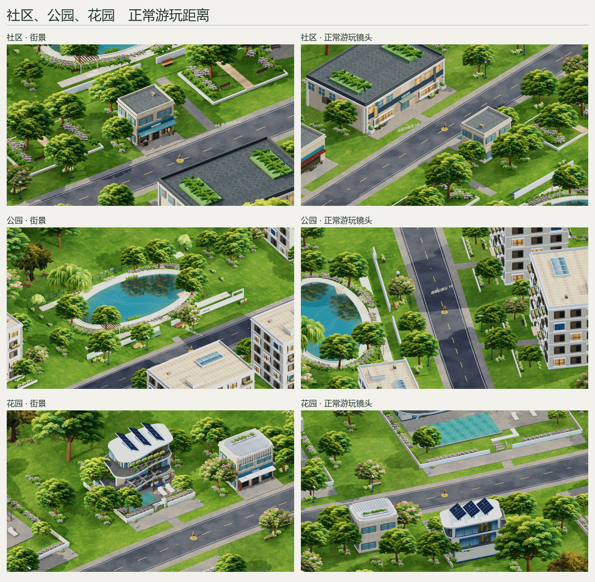

# 社区、公园、花园 · Unity 实机对照

本轮三区全域改造的花境、材质、相机参数和十二张同机位对照见[社区、公园、花园扩区复核](社区公园花园扩区/README.md)。

换机续作从[三区与赛场美术交接](换机交接.md)开始。内含本轮原帧、分区和赛场的验收口径，以及下一轮树冠、林下光影、水面和玻璃的具体对照位置。

2026 年 11 月 26 日，`art/experiment`。三片区的户外地图、住宅与商铺外观、公共设施、绿化、地面、水岸和三个赛场均已接入游戏。各区沿用现有路网、门址和赛道。下表列出的地点包含沿街营业场所、公共地点及住宅门牌，同一类住宅共用建筑模块。

| 区域 | 正常游玩距离下的变化 | 概念与实机 | 地点实拍 |
| --- | --- | --- | --- |
| 社区 | 锦线裁缝铺采用浅砖、石窗台、青布篷和暖色橱窗；住宅院内与街角加入树荫、座椅、绣球和分组花床。正常日照下保留墙色与沥青的冷暖差。 | [裁缝铺与片区双视角](02-社区概念与实机.jpg) | [58 处](02-社区地点索引.jpg) |
| 公园 | 池岸重做浅石压顶、环形步道、低墙与出入口。柳树、花境、池水和公共设施共用新建园区的材质；街外地面通过草色与种植过渡。 | [池岸与片区双视角](03-公园概念与实机.jpg) | [68 处](03-公园地点索引.jpg) |
| 花园 | 三层别墅的悬挑板沿前缘起伏，分叉支柱、深窗带、光伏鳍片和泳池庭院可从街上辨认。相邻商铺使用金属百叶、设备顶花池与电子橱窗，路灯使用细长挑臂。 | [别墅街与片区双视角](04-花园概念与实机.jpg) | [56 处](04-花园地点索引.jpg) |

每张分区对照图左列取自已经确认的概念板，右列为同地点的 Unity 相机画面。四行依次展示街景 A、街景 B、鸟瞰 A、鸟瞰 B。上图右列保留玩家到达对应门口时的游戏镜头，未把角色移到构图更好看的位置。[原概念板](../分区概念/README.md) · [182 个地点的名称、ID 和图版位置](地点索引.tsv)

## 赛场与游乐设施

| 赛场 | 实机可见的区分 |
| --- | --- |
| 社区俱乐部 | 墨绿金属棚、分排座席和支架、砖墙器材房、临街接待处。 |
| 公园竞速场 | 浅白轻顶、分段座席、浅石场地、花境与整洁的维修设施。 |
| 花园大奖赛 | 光伏顶棚、白瓷构件、玻璃服务舱、计时设施和冷色护栏。 |

三处车库与接待处沿既有桥头组成临水平台，车道与入口之间留通行口。赛道实拍包含看台正面、整座赛岛、入口、车库、水边和弯道。[看台与全景](赛场看台与全景.jpg) · [入口与弯道](赛场入口与弯道.jpg)

默认镜头复拍时，社区摩天轮曾投影在裁缝铺和玩家之间。街景相机现按游乐场基座的位置与当前取景范围处理前景遮挡；在售票处和全景机位仍能看到完整设施。对照图记录了同一街口修正前后，以及两个游乐场各自的入口和全景。[摩天轮与街景视线](摩天轮与街景视线.jpg)

三区的中性日光随游戏时间变化。复拍固定日期，分别置于 10:30、18:10 和 21:30。[三区昼夜实机](三区昼夜实机.jpg)

## 画面对比

以每区四个固定视角检查地标轮廓、道路与绿化占比、建筑材质、受光面和树荫。远景最明显的差距是概念里沿路和湖岸的树冠之间仍能看到空隙、林下亮斑及灌木层次。实机部分树冠的高度、外形和间距仍相似。近景里，裁缝铺陈列及树下人物较少，池水反射的细碎层次较少，花园别墅的玻璃透光、临街占比和光伏支架曲线也与原图有差距。

| 区域 | 本轮早期四镜头均值 | 本轮交付四镜头均值 | 街景 A / B | 鸟瞰 A / B |
| --- | ---: | ---: | --- | --- |
| 社区 | 80.5 | 86.7 | 84.4 / 85.0 | 88.9 / 88.5 |
| 公园 | 80.2 | 86.3 | 84.0 / 83.5 | 89.0 / 88.9 |
| 花园 | 81.8 | 85.1 | 82.5 / 83.2 | 87.2 / 87.4 |

表中使用 0–100 的像素色差参考分。将概念四分图与对应实机帧按面积采样到 128×72，在 sRGB 中对各像素的三个通道分别取绝对差，再按 `100 × (1 − 平均绝对差 / 255)` 计算。各图使用整幅画面，未经配准、调色或局部形变。此分数同时受色彩和构图影响。相近的均色也能带来高分，具体造型须查看并排原图。**本次尚未达到约定的 95% 相似度验收线。**

## 复拍方法

使用 Unity 2022.3.6f1、URP、Direct3D 11，经过游戏的异步地图加载和开局流程进入 Play Mode。相机脚本要求当前世界根节点具备 `BakedCityMap`；如果退回临时生成地图，会直接报错。实机彩色图直接从游戏相机读取，其中街景、鸟瞰和赛场原帧为 1600×900，单个地点索引原帧为 512×288。拼图仅缩放、排版、添加图注。截图关闭交互 UI，图中的人物、物件和光影来自游戏。

换机复拍时，在项目副本把 [TownMatchCamera.cs](../../../../tools/district-art-capture/TownMatchCamera.cs) 放入 `Assets/ArtCapture/Editor/`。运行项目自带的 `CityMapBaker.RunBakeOnly` 预生成完整城市，然后指定 `PCSHOP_TOWN_SHOTS` 为输出目录、`PCSHOP_BAKED_REVIEW=1`，用 `-batchmode -force-d3d11 -executeMethod TownMatchCamera.Run` 进入 Play Mode。脚本设置独立临时存档目录。日志以 `CONCEPT_CAMERA_CAPTURED baked=True sites=182` 确认复拍来源与地点数。生成的城市缓存沿用项目原有的本机忽略规则；构建入口会依据模型与资源指纹重新生成缓存。

复拍后，用 [contact_sheets.py](../../../../tools/district-art-capture/contact_sheets.py) 依次传入截图目录、分区概念目录和图版输出目录，可重建对照图和地点索引。材质来源、提示词和游戏内使用的文件见[材质制作记录](材质制作记录.md)。
