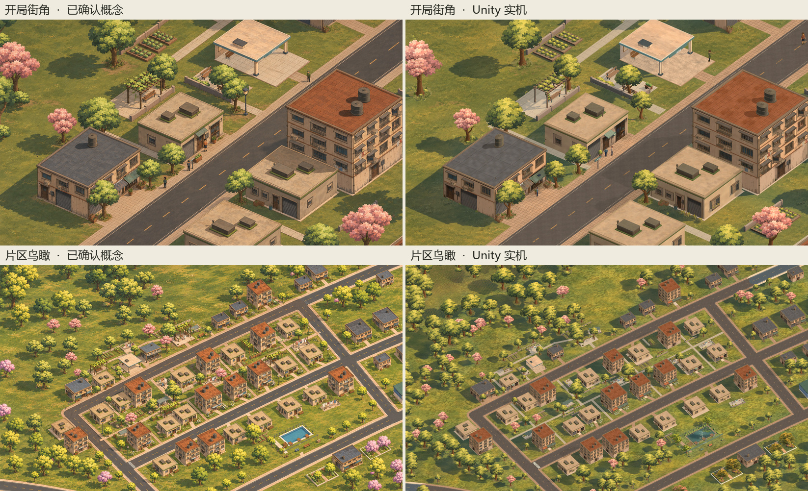

# 城郊旧居街画风定稿

2026 年 11 月 26 日，项目负责人查看城郊开局近景及片区鸟瞰的并排实机图后，确认第 12 轮作为其余街区沿用的画风基准。审批范围为城郊。社区裁缝铺、河岸公园、花园别墅及赛场保留各自的概念、实机和验收记录。

## 后续街区沿用的做法

1. 从游戏中截取真实街区，固定正向、回望和鸟瞰机位，以及时刻、光照和画面尺寸。用这些截图绘制同一布局的局部和整片概念。多角度定稿与实地尺寸有冲突时，保留真实地块、房源、门位和可通行范围。
2. 同类建筑先复用已有模型。城郊有小平房和多层住宅，主角从小平房起步，中介沿用两种房型。用窗台、雨棚、屋面设备和前院植栽区分同类住户。墙面以暖灰泥和轻微风化为主，维持店门、房门和街巷容易辨认的明度层次。
3. 草与植被按视距制作。脚边有成簇的短草和细小笔触，中景能辨出花带、树枝和叶团的前后关系，鸟瞰能看清树群之间连续的草坡。按两个视角和实地净空确认树干、花架和菜畦的位置，给人行空间留足宽度。
4. 在 Unity 正常游戏光照下复拍。分别看阳面和背光灰泥、屋面接缝、石板、受光草地、树影和水面，再用连续转镜检查遮挡。项目的 95% 标准主要验收画风、材质和空间观感。整帧色差仅用于定位差异。

## 定稿依据

| 项目 | 归档值 |
| --- | --- |
| 分支、烘焙版本 | `art/experiment` · 正式地图 v16 |
| 地图源指纹 SHA-256 | `6805D7228B38223B96D0410387C899AD229803E0F424F67B3116AE31D308545E` |
| 校准机位的整帧色差参考分 | 开局 95.95，院内回望 95.08，鸟瞰 91.64 |
| 布局与通行 | 城郊东西巷口的砖面收至车行道边界，住宅和真实门位保留 |

可按三张原固定镜头对比前后，也可以看整段转镜确认树冠、窗洞和房屋深度。[住宅三机位](城郊住宅三机位.jpg) · [校准机位](城郊住宅三机位-补充校准.jpg) · [后坡与前院](城郊后坡与院边细节.jpg) · [实机转镜](旧居街实机转镜.webp) · [完整复核记录](实机复核记录.md)
