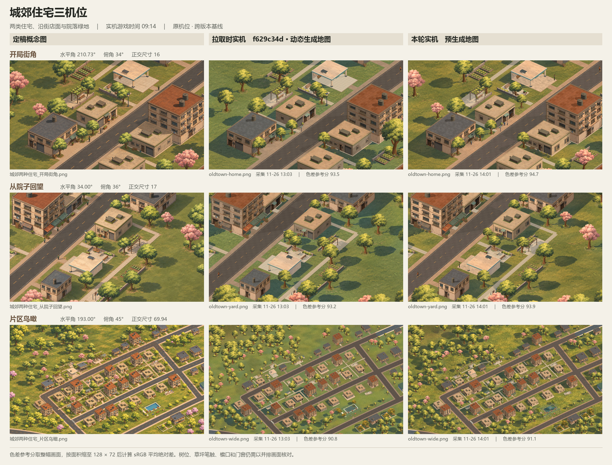

# 城郊旧居街与后续三区实机复核

2026 年 11 月 26 日 · Unity 2022.3.6f1 · URP · `art/experiment` · 拉取时版本 `f629c34d`

验收保留真实地块、出入口和房源。95%以画风、材质与空间观感为准。图中住宅、铺面、乔木和水面均来自游戏世界，复拍前后使用同一套已确认概念。

项目负责人已确认第 12 轮城郊定稿，选为后续街区沿用的画风基准。其余三区和赛场分别保留本轮实机与审看结果。[城郊画风定稿](城郊画风定稿.md)

### 定稿与实机的核对结果

| 对应部位 | 已确认概念图 | 本轮实机 | 观察方法 |
| --- | ---: | ---: | --- |
| 城郊远草底色 | 148,141,60 | 150,142,60 | 向阳草坡中位 sRGB，同一片草地 |
| 城郊远草细笔触 | 4.30 | 4.48 | 0.65–2.1 像素，亮度局部起伏 |
| 城郊远草中等色块 | 4.29 | 4.00 | 2.1–6.5 像素，亮度局部起伏 |
| 候车亭前石板 | 218,181,143 | 215,177,140 | 灰泥和地面分别取样 |
| 花树冠中位亮度，正向 / 回望 | 141.20 / 148.63 | 141.45 / 149.20 | 同棵树的日间花色 |
| 花树阴影与邻近草地的亮度比 | 0.668 | 0.676 | 同方向取阴影内部，避开树干 |

两类住宅的六处正面、端墙、侧墙亮灰泥，实机与定稿的 ΔE76 范围为 0.7–2.1。三个固定镜和三个校准镜均采自同一张地图。前院相邻八户保留了两侧花圃、门道和各自的房源。站旁的乔木使用两个视角定位，树干避开三垄菜畦。

后坡按定稿定位 16 个树位，其中 15 株落在新锚点，另一个位置沿用相距 1.35 米的原树。新树的冠幅和背光叶按远景单独调整。旧居内排在真实院墙与步道之间增加一座窄葡萄架和两只矮花箱，保留原门位。后坡在相同裁切的整帧色差参考分从第 10 轮 87.77 到第 12 轮 90.01。[后坡和两处院边原帧裁切](城郊后坡与院边细节.jpg)

**美术判读**　实机近景已经能同时读出红瓦楼与矮平房的体量、米灰色墙面的受光差、侧院花树和砖地。转到鸟瞰时，还要看外围树丛留下的草地长什么形状、院墙后面能露出多少花架和窗台。实机保留游戏中的真实门向、可出租建筑和可通行巷道。文中整帧色差、局部色差与笔触尺度各有独立记录，95% 的风格验收需要对照图上的整体观感。

**空间和通行**　两处巷口收在真实路缘。社区裁缝铺和花园沿街铺的入口中心、两侧步行区、车辆边界都在游戏里实走复核。社区公园和河岸公园的环道分别沿 64 段走完，人物在石岸、门洞和人行道之间连续过渡。

## 城郊旧居街

- 主角的低层住宅和较大的多层住宅共用已有美术资产，继续沿用中介房源与真实门牌。局部变化集中在檐下、窗框、雨棚、盆栽和院落。
- 用正反两个朝向分别校准灰泥的受光和背光，再检查暗窗、红瓦、浅色平顶和深灰卷材。草的底色、草梢和地面阴影单独处理。街边砖保留细缝，远处降低砖缝对比，防止闪烁。[墙面分区取样](住宅墙面取样.tsv)
- 开局、回望和鸟瞰共同定位花树与内排住宅的绿带。乔木、灌木、根际土和前院花草都落在真实地面，门口和巷内留出步行空间。
- 对照图可切换原固定机位和经屋角校准的机位。近景便于看灰泥、卷材接缝、窗框与树梢，中远景看草的细笔触、成组色块和街巷前后的空间。[开局校准双图](城郊开局街角.jpg) · [三机位校准对照](城郊住宅三机位-补充校准.jpg) · [前院放大](城郊前院局部对照.jpg) · [取样位置](城郊材质取样位置.jpg) · [草地、树冠与铺装](城郊草地树冠与铺装取样.tsv) · [树影](花树投影取样.tsv)
- 两处巷口的旧砖面穿过人行道伸入机动车道，西、东分别约 2.76 和 2.97 平方米。修复后两处与车行面的重叠面积均为零。路边草簇也避让公共硬地。[巷口修复前后](城郊两处巷口.jpg)
- 摄像机上午 09:14 拍摄城郊住宅。三张原固定镜用于跨版本比较。补充机位用同一组屋角匹配定稿的小幅平移、俯角和鸟瞰焦距，旧版与新版分别在 Unity 内重新渲染。图版只排版或缩放。池水另有本区较新的双视角定稿。[钓场与池岸](城郊钓场.jpg)
- 以开局机位为中点左右各转 18°，连续记录 64 个真实游戏相机角度；动图可检查屋檐下的厚度、植物的前后遮挡和草地笔触随观察角度的表现。原 PNG 已保存在原帧包。采集时设置 `PCSHOP_TOWN_ORBIT=1`。[转镜实机动画](旧居街实机转镜.webp)

| 城郊机位 | 原机位拉取时 | 原机位本轮 | 校准机位拉取时 | 校准机位本轮 |
| --- | ---: | ---: | ---: | ---: |
| 开局街角 | 93.50 | 94.66 | 94.51 | 95.95 |
| 院子回望 | 93.18 | 93.94 | 94.09 | 95.08 |
| 片区鸟瞰 | 90.79 | 91.08 | 91.19 | 91.64 |

## 社区、公园和花园

- **社区裁缝铺**使用浅色灰泥、实物门楣和青色斜雨棚。橱窗后分开布置缝纫台、布架和人台，营业状态控制外摆。长椅坐有三位街坊，前方植被降低，让行人在正常镜头里可见。[四个角度](社区裁缝铺四机位.jpg)
- 裁缝铺的两辆自行车、木棚、四根柱和车架落在店铺与公共广场之间。街景正反两镜中有树遮挡；原帧包内 `02Cycle.png` 是从同一侧院空带拍到的车棚近景。
- **河岸公园**用岸边植物和独立水面倒影区分水深、睡莲、远近水纹。门洞保留 3.30 米，步径从街口接入，环道与步行判定取同一组 64 段岸线。玩家按正常方向输入能绕完整圈并返回。[池岸双向与鸟瞰](公园池岸四机位.jpg)
- **花园别墅与沿街商店**保留原有地块和真实间距。三层退台、叉形支柱、薄檐、三片光伏和可看穿的展廊形成建筑轮廓。水面和玻璃的光照均来自当前游戏环境。[别墅与商店四机位](花园别墅四机位.jpg)
- **三个赛场**依次使用社区金属棚、公园白色悬挑篷、花园光伏看台和透明服务舱。实体座椅朝向弯道，公园看台的铺地避开防撞边界。相同焦距的看台补拍与原固定 A 镜分别保存。[三处赛场看台](三处赛场看台.jpg)
- 额外拍摄社区、公园、花园六张近景，在 Unity 中调整正交镜头的范围，使树叶、波纹、玻璃后面的陈设有足够的屏幕尺寸。真实门位和店铺、住宅、围墙之间的距离均用于此组。原四机位统计仅使用原相机参数。[三区正反向近景](三区主体近景.jpg)
- 河岸公园另外量取石岸、池心与近岸倒影的亮度分布。实机的树影随日照和镜头变化。青湾钓场采用最新正反向草图的青绿色水面，三区的草面分别在各自正反两个视角取样。[三片草地](三区草地取样.tsv) · [水面与岸缘](池岸取样.tsv) · [青湾水面](青湾钓场水面取样.tsv)
- 独立复核记录保留了第 8 至第 12 轮的差异。河岸公园正向镜头池心最高 2% 亮度的分界值达到 196.4，定稿为 200.6。反向镜头较暗，青湾正向的少数浪尖较亮。从两个方向一起看水色和沿岸植被，有助于避免为单帧调坏另一个方向。[逐轮材质审看](逐轮材质审看.md)

## 工程中的位置

以下路径相对于项目根目录。城市沿用 `Assets/Resources/Data/city_layout.json` 中的布局。

| 范围 | 游戏中使用的资源或脚本 | 本轮重点 |
| --- | --- | --- |
| 城郊住宅和院落 | `Assets/Scripts/Game/Runtime/StreetWorldBuilder.OldQuarter.cs`、`StreetWorldBuilder.Courtyards.cs`、`StreetWorldBuilder.Verges.cs` | 小平房和多层楼复用原模型；端墙窗台、矮花带、菜畦、树根与巷道净空 |
| 住宅立面、花树与车站 | `Assets/Resources/OldQuarter/QuarterPaint.shader`、`QuarterCanopy.shader`、`RoutePortrait.shader`、`StationPaint.mat` | 屋面卷材与砖缝、灰泥明暗、花叶亮色、站台石板 |
| 城郊巷口和铺面 | `StreetWorldBuilder.RoadSurfaces.cs`、`Assets/Scripts/Core/Session/GameSession.Steer.cs` | 公共硬地边界、商铺门前步行和车辆通行范围 |
| 草地、枝叶、光照 | `Assets/Resources/OldTown/Meadow.shader`、`Crown.shader`、`Surfaces/streetBoughs.png`、`Assets/Settings/PCShopSell_URP.asset` | 近草、远草、活树的枝团与原生叶片。远景保持级联阴影，树、楼与行人随时刻投影 |
| 水岸、公园和钓场 | `Assets/Scripts/Core/World/ParkPondWalk.cs`、`CityVenueView.cs`、`LakesideReflections.cs`、`Assets/Resources/Shaders/LakeWater.shader` | 石岸收边、池面碎光、反射和正常步行。青湾按独立钓场定稿验收 |
| 社区店铺和别墅 | `StreetWorldBuilder.DistrictArchitecture.cs`、`CityArchitecture.ModernVilla.cs`、`GardenStructures.cs`、`DistrictFinishes.cs`、`GameController.Neighborhood.cs` | 真实店门、营业与打烊、侧院木棚、玻璃后的展厅、光伏支架、街坊和椅座 |
| 赛场、实机采集 | `RaceTrackView.cs`、`tools/district-art-capture/TownMatchCamera.cs`、`tools/district-art-capture/walking/` | 分区看台、比赛边界、固定镜头、补充近景和正常输入的行走记录 |

| 四个原固定机位均值 | 拉取时预生成实机 | 本轮预生成实机 |
| --- | ---: | ---: |
| 社区裁缝铺 | 86.72 | 87.29 |
| 公园池岸 | 86.36 | 86.82 |
| 花园别墅 | 85.07 | 85.19 |

这里的整帧数字沿用项目原有算法。两幅图按面积缩至 128×72，再计算 `100 × (1 − sRGB 三通道平均绝对误差 ÷ 255)`。它对道路、门窗和投影的位置也敏感。判读材质时，应同时看同朝向的墙面、草地笔触、叶簇轮廓，以及主体前后能否辨出空间层次。[逐镜色差](三区与赛场逐镜色差.tsv)

## 运行复核与复现

- 种子 914，街景与比赛场日间取 10:30，黄昏取 18:10，夜间取 21:30。主要图片为 1600×900，地点索引为 512×288。采集先等加载界面关闭，再拍真实游戏界面、固定镜头和反向镜头。[正常游戏界面](四区游戏界面.jpg) · [昼夜实机](三区昼夜同机位.jpg)
- 烘焙版本 16，正式模式。运行时记录的源指纹为 `6805D7228B38223B96D0410387C899AD229803E0F424F67B3116AE31D308545E`。城市布局指纹为 `6CB7C90D59A70924EFF3EAF212A2521E323B8E212FFA7578B45DEE9B77BD931D`。社区、公园、花园逐处采集共 182 张。公园走圈和商店门前铺装另以正常方向输入和车辆行驶复核。[地点索引](182处地点索引.tsv) · [公园行走](两处公园行走.tsv) · [店前行走](店前铺装行走.tsv)
- 散叶、水面反射、贴图和照明在实机下工作。本轮使用 URP 的直接光、级联软阴影和水面反射。当前视图未使用硬件光线追踪。[贴图制作记录](贴图制作记录.md)
- 在工程副本将 `tools/district-art-capture/TownMatchCamera.cs` 复制到 `Assets/ArtCapture/Editor/`。运行 Unity 编辑器方法 `CityMapBaker.RunBakeOnly`，再设置环境变量 `PCSHOP_BAKED_REVIEW=1` 和输出路径 `PCSHOP_TOWN_SHOTS`，运行 `TownMatchCamera.Run`。日志中可核对 `CAPTURE_MAP` 和 `CONCEPT_CAMERA_CAPTURED baked=True sites=182`。复现行走记录时，同时复制 `tools/district-art-capture/walking/` 中的两个脚本至同一 Editor 目录，并设置 `PCSHOP_WALK_CHECK=1`。两段路线在拍摄完成后依次执行。
