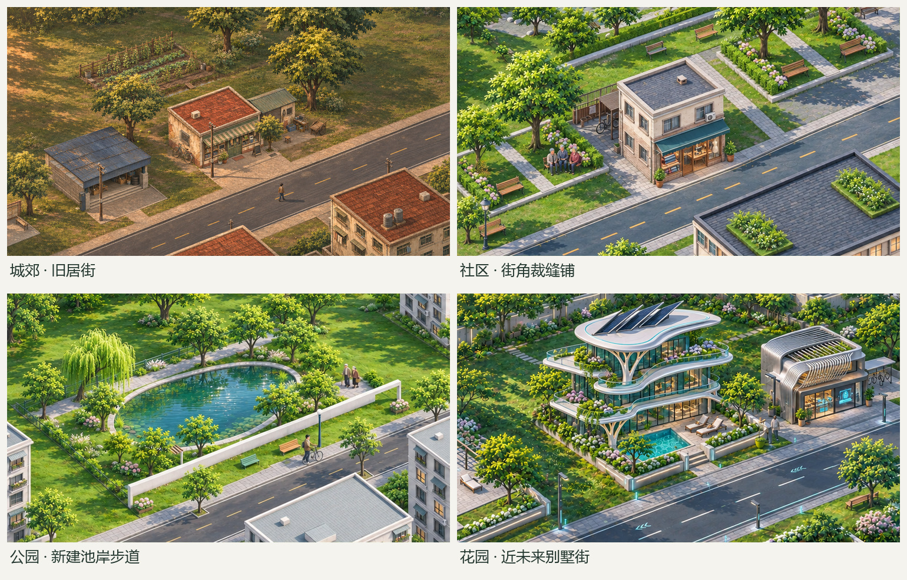

# 四区场景概念 · 分区用图

2026-11-25。四区共用等距经营视角、手绘材质和柔和接触阴影。城郊的暖旧感随着地区发展逐级减弱。下图用于确定外观，当前实机效果需用游戏镜头另行对照。

| 地区 | 地点与看图重点 | 原图 |
| --- | --- | --- |
| 城郊 | 旧居街。沿街小店、菜畦、旧雨棚，午前暖光；草地依已确认的实机日景。 | [原双视角](../../四阶段街区概念/01-城郊旧居街-双视角.jpg) · [已确认的实机与材质](../../old-quarter/README.md) |
| 社区 | 当代生活街区。裁缝铺的浅色砖、青色雨棚和通透橱窗，树下有人歇脚。地面保留日常使用痕迹，白墙受光后仍看得出本色。 | [社区街角与全景](02-当代社区.png) |
| 公园 | 新建片区。椭圆池、浅石收边、清水、亮色矮墙和连贯步道。新旧程度主要看池岸接缝、设施表面和绿化养护。 | [池岸双视角与全景](03-新建公园.png) |
| 花园 | 近未来宜居街区。三层曲线悬挑、分叉支柱、光伏鳍片、玻璃、泳池与庭院。相邻商店的遮阳和电子橱窗也进入同一年代，鸟瞰可识别成片白色曲面屋顶。 | [别墅街双视角与全景](04-近未来花园.png) |
| 四区赛场 | 左上为城郊铁皮棚，右上为社区俱乐部，左下为公园白篷看台，右下为花园光伏看台与服务舱。看台、器材房、铺装和绿化一起递进。 | [四区看台](四阶段赛场.png) |

三区概念板上排为同一地点的左右两次观察，下排为该区域的两张鸟瞰。图像以旧版机位和地标为参考，局部树位、门窗、设施数量可能随视角有差异。建模以游戏中的道路、地块边界、通行口和赛道中心线为准。概念中的光伏板、智慧灯杆和电子设施用于美术表达，不引入新的玩法依赖。

## 制图记录

底图来自[四阶段街区概念](../../四阶段街区概念/)的社区、公园、花园双视角及全景，赛场沿用[四处赛场初稿](../四处赛场定稿.png)。下列为改绘使用的分区提示。

### 社区

以附图为严格构图底图，重画 PCShop 的正式三维场景美术概念板。社区。中国当代普通、住得舒服的成熟街区，晴朗上午11时中性日光。核心仍是两层社区裁缝铺，保留营业中的橱窗、布卷、店门、住宅与绿荫；维护良好，浅米灰砖、暖白粉刷、略有生活磨损，素净墨青布篷、干净透亮的玻璃，蓝灰街面，草绿色和深绿色为主。亲切日常、价格平实，没有豪宅感。彻底移除全屏泛黄、昏暗阴影、怀旧棕调，墙根无大块斑驳。 输出横向16:9满幅2×2等大无缝四格。左上原近景A，右上同地点反向B；下排同一片区两个鸟瞰角度。相机、地标、建筑外轮廓位置、路网、遮挡顺序精确照原图。四格同步改同一世界，两近景同一栋建筑同一设计。保持可建模的斜俯视三维手绘笔触，保留色阶层次、接触影和真实材质肌理。无文字、无图标、无边框。

### 公园

以附图为严格构图底图，重画 PCShop 的正式三维场景美术概念板。公园。新近建成的中国城市公园片区，崭新而有人使用。保留本图同一个椭圆河岸池、垂柳、步道、景墙、临街公寓、路网、跨湖桥。新切浅灰石材的细接缝、平整的白色清水混凝土、纤细浅银桥栏、清澈通透的蓝绿水、浅滩水草和碎光。大组团的鲜绿草坪和初成形的园林，中性明亮天光与舒服的蓝灰阴影，房屋白灰、较浅的屋顶。不要旧墙、复古滤镜、金黄树冠、破旧的暗池。 输出横向16:9满幅2×2等大无缝四格。左上原近景A，右上同地点反向B；下排同一片区两个鸟瞰角度。相机、地标、建筑外轮廓位置、路网、遮挡顺序精确照原图。四格同步改同一世界，两近景同一栋建筑同一设计。保持可建模的斜俯视三维手绘笔触，保留色阶层次、接触影和真实材质肌理。无文字、无图标、无边框。

### 花园

以附图为严格构图底图，重画 PCShop 的正式三维场景美术概念板。花园。中国生活模拟游戏解锁的近未来高科技花园城区。非常明确的下一时代！保留同一栋三层别墅与庭院泳池、旁边商铺的原有体量和位置。重新设计银白陶瓷外骨架的悬挑檐、细框蓝青调光玻璃、水平光伏百叶、细小低亮度青色导视灯、嵌在栏杆和墙缝中的线性照明。银白金属环与青色舱体的摩天轮在鸟瞰中仍是原位置。有人居住的质感、清水、深绿树冠与精心修剪的庭院。晴朗白天也能靠结构和材质认出科技感。无赛博朋克霓虹夜城、无金色滤镜、无漂浮UI、不加高楼、不改街块。 输出横向16:9满幅2×2等大无缝四格。左上原近景A，右上同地点反向B；下排同一片区两个鸟瞰角度。相机、地标、建筑外轮廓位置、路网、遮挡顺序精确照原图。四格同步改同一世界，两近景同一栋建筑同一设计。保持可建模的斜俯视三维手绘笔触，保留色阶层次、接触影和真实材质肌理。无文字、无图标、无边框。

复核后进一步调整。

精确改绘这张游戏城市概念设计四联图，必须让整片「花园」一眼看出是比当代公园更先进一代的白天的未来城市。严格沿用同一款温柔笔触的细致三维手绘城镇、绿意花园、等距镜头、现有道路布局与四格（2x2、无边线无文字无UI）。保留相同的池、花园宅基地、主建筑位置，邻街店、全景远处的摩天轮、桥、湖、赛道和住宅数量、方向。上面两格必须是同一栋房子的两个真实机位，屋面泳池花园和临街店的相对位置完全相同。做真正的造型概念设计：主屋彻底重设计为可在 Unity 制模的具有记忆点的3层白瓷模块悬挑建筑。明确画出不对称弧形细框的前伸露台，深凹的蓝青色低反玻璃窗带，三片倾斜的深色光伏鳍板，一道融入建筑轮廓的淡青线型指示，与绿植穿插的轻巧白色树形支撑。邻店同样进入下一代，做参数化遮阳、哑光金属、电子橱窗；道路采用冷灰哑光材质、嵌入式导向与窄型智能路灯。整个下排在目前可见的宅基地上替换这些建筑模件和沿街科技设施，保留城市绿量和布局，鸟瞰也能看到富有节奏的珍珠白屋顶、青灰透光顶和花园；尽量控制黄褐色调，清澈冷中性上午日照，有成片树荫和轻暖室内生活光；建筑明亮但质感丰富，干净高级，宜居。科技感明显强于带太阳能板的现代住宅。不要巨型塔楼、满街灯带、夜景、赛博朋克、太空飞车，不要扁平线稿。

### 赛场

以附图四格为不可移动的同机位布局，重绘手绘三维场景概念。左上城郊原样，旧木座位灰蓝铁皮棚。右上当代正常社区俱乐部，墨绿清洁金属棚和自然绿植。左下崭新公园竞速场，看台浅银白檐、轻薄现代支撑和清新的园林。右下近未来大奖赛，悬挑银白顶檐、局部蓝黑光伏百叶、青色细光带与调光玻璃挡风屏；同位置的维修棚、赛道、看台、弯道和机位必须保持完全一致，四格均为白天。每格必须出现显著不同的看台材质和设计，右下白天也可见科技感。无文字无水印，16:9四格满版。

复核后进一步调整。

修改这张真实可制模的手绘3D竞速赛场四格概念。保留原图的取景、赛道曲线、中心看台占地、服务房占地、四格格局，无文字无分隔线。保持左上角城郊图原样。右上普通当代中国社区运动俱乐部：当代墨绿金属顶、浅灰储物室和自行车停放架、干净树荫与自然绿草，日光中性。左下是刚建成的公园运动中心：白色薄篷、新浅灰器材房、维护很好的浅绿草场、浅灰铺地、成组花境和年轻行道树，明快新净。右下是完全不同等级的日间未来花园赛场：流线悬挑看台、珍珠白瓷与哑光银色板、深蓝玻璃、光伏鳍片、电子计时杆；左边的小库房也替换为整洁的半透明智慧服务舱，保持相同落地点；弯道边的护栏使用银灰防撞带与少量青绿标识，机能绿岛由观赏草、深绿地被和成行树组成。三个新地区逐步自然中性到冷净白天日光。最重要不能四地区照搬同一个灰色棚屋和同一片黄色草地。请让环境管理方式、场馆体量层次和服务设施讲出四阶段发展，保持统一细腻手绘表现和可辨材质，不做夜景或浮夸霓虹。

